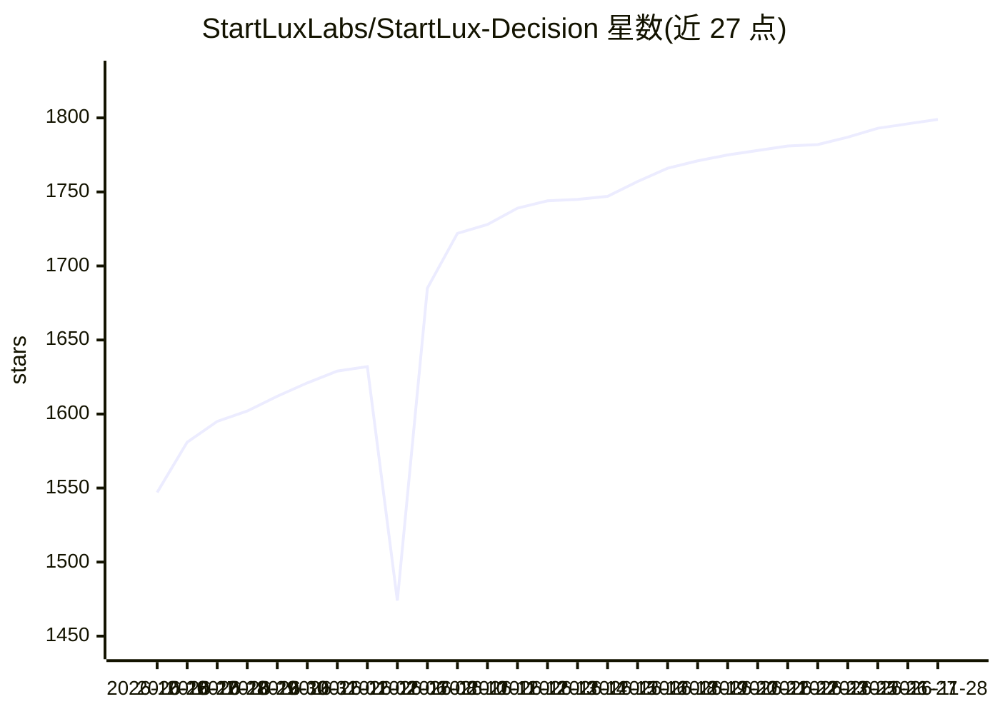

# StartLuxLabs/StartLux-Decision

⭐ 1,799 · Python · Apache-2.0 · 推送 2026-11-27 · [GitHub](https://github.com/StartLuxLabs/StartLux-Decision) · [官网](https://decision.startlux.com/) · 组织维护

**开源决策模型家族及其推理引擎：一次前向输出各选项概率**

StartLux-Decision 是一组开放权重的决策模型（0.8B–27B 及 35B-A3B）加配套推理引擎与 HTTP 服务器。输入状态（文本/JSON/图像）与类型化问题，返回每个选项的概率：choice/noul/score 三种题型；Instant 单次前向作答，AutoThink 在最高概率低于门限（默认 0.6）时生成短推理后再读出答案。引擎以 vLLM 插件实现双向注意力，兼容 /v1/systemone API；另提供 StartLux-Prism 引擎直接从 GGUF 读取模型。仓库含基准测试、量化文档与生产服务指南。

## 筛选速览

| 维度 | 判定 | 备注 |
|---|---|---|
| AI 角色 | `ai-ecosystem` | LLM/agent 周边工具 |
| 许可风险 | `permissive` | Apache-2.0 |
| 部署形态 | `library` | 以包/库形式分发 |
| 模型依赖 | local-ok | 支持本地模型 |
| 硬件要求 | — | 无带数字的原话,不猜 |
| 安装摩擦 | `medium` | 含编译或系统依赖之一 |
| 成熟度 | — | 结构信号不足 |

## 能力要点

- Instant 单次前向作答，AutoThink 低于置信门限时生成短推理并二次读出
- 支持 choice、noul（yes 概率）、score（每级概率）三类类型化问题
- 引擎覆盖 vLLM/StartLux-Prism/llama.cpp/MLX/transformers 五种后端
- 提供 none_probability 控制与 FP8/GGUF/MLX 量化构建

## 适用场景

- 为工单分类、判断类问题批量获取校准概率
- 游戏或机器人中实时做离散决策调用
- 在 Apple Silicon 或无 vLLM 机器上用 GGUF/MLX 运行模型

## 场景标签

`推理引擎` · 领域:训练与推理

## 证据(README 行号)

> L16: StartLux-Decision is a family of open decision models. Given a state (text, JSON or images) and a set of typed
> L22: This repository contains the inference engine and HTTP server for both variants. The API is compatible with System
> L108: To run the models yourself, install the package into the same Python environment as vLLM. It carries the vLLM plug

## 星数曲线

2026-10-26 1,547 → 2026-11-28 1,799（+252）

---
*卡片 v1 · prompt 1.4 · 生成 2026-11-28 · 置信度 high · 依据 README sha `25a87920c1dd` · [字段定义](../../DATASET.md)*
