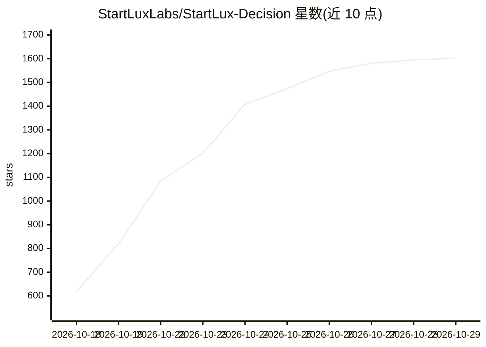

# StartLuxLabs/StartLux-Decision

⭐ 1,602 · Python · Apache-2.0 · 推送 2026-10-23 · [GitHub](https://github.com/StartLuxLabs/StartLux-Decision) · [官网](https://decision.startlux.com/) · 组织维护

**开源决策模型族（0.8B-27B）：一次前向给出每个选项的校准概率**

提供 0.8B 到 27B 的开源决策模型与配套推理引擎/HTTP 服务器：输入状态（文本/JSON/图像）与带类型的问题集（choice/noul/score），模型对每个选项返回概率。Instant 变体单次前向作答；AutoThink 变体在最高概率低于门槛（默认 0.6）时先生成短推理再读答案。引擎支持 vLLM（含专用插件）、llama.cpp、MLX 与 transformers 后端，提供 GGUF/MLX 量化构建、API 密钥与 HTTPS 等生产部署功能，以及 bamboonode.dev 免费托管。

## 筛选速览

| 维度 | 判定 | 备注 |
|---|---|---|
| AI 角色 | `ai-native` | 本体是模型或模型工具 |
| 许可风险 | `permissive` | Apache-2.0 |
| 部署形态 | `library` | 以包/库形式分发 |
| 模型依赖 | local-ok | 支持本地模型 |
| 硬件要求 | — | 无带数字的原话,不猜 |
| 安装摩擦 | `low` | 无编译、无系统依赖或容器化 |
| 成熟度 | — | 结构信号不足 |

## 能力要点

- 对 choice/noul/score 三类问题逐选项输出概率
- AutoThink：低置信时触发短推理，RLCD² 训练
- 支持 vLLM（专用插件）、llama.cpp、MLX、transformers 四种引擎
- 提供 none_probability 无匹配选项检测与 bench/eval/quantize 命令

## 适用场景

- 客服工单分类、路由等需要带置信度决策的场景
- 游戏/机器人每帧实时决策（示例含国际象棋、StarCraft II）
- 在自有 GPU 或 Apple Silicon 上部署量化决策模型服务

## 场景标签

`推理引擎` · 领域:训练与推理

## 证据(README 行号)

> L14: StartLux-Decision is a family of open decision models. Given a state (text, JSON or images) and a set of typed
> L16: (`choice`), a yes or no judgement (`noul`), or a level on a scale (`score`). Instant models answer in a single forw
> L20: This repository contains the inference engine and HTTP server for both variants. The API is compatible with System

## 星数曲线

2026-10-18 618 → 2026-10-29 1,602（+984）

---
*卡片 v1 · prompt 1.4 · 生成 2026-10-21 · 置信度 high · 依据 README sha `6d9f2c1cc8ee` · [字段定义](../../DATASET.md)*
