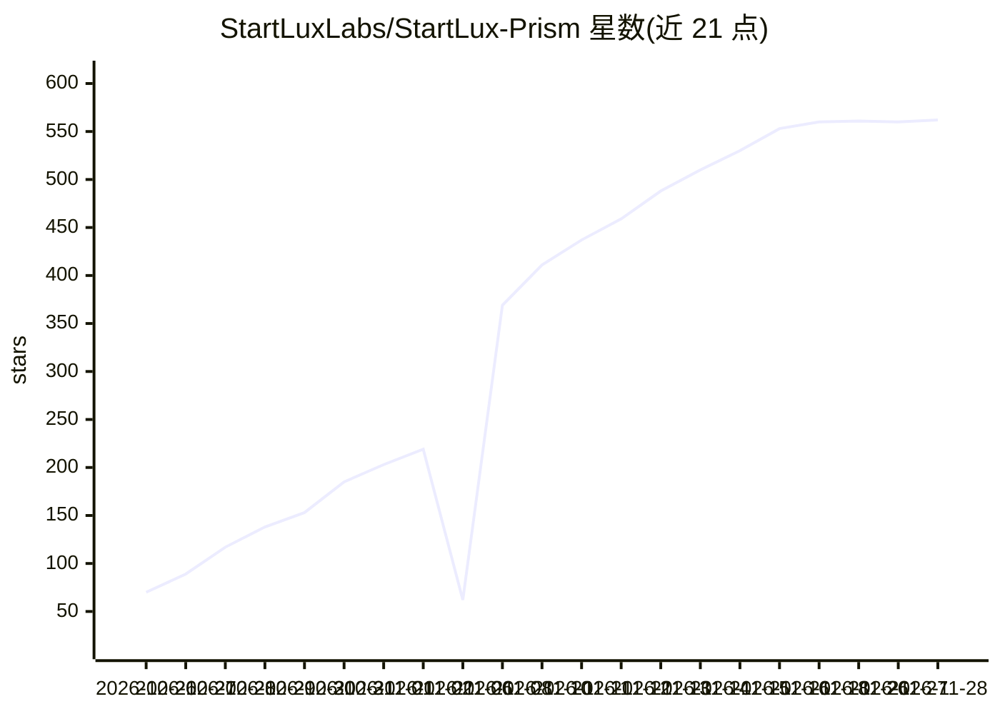

# StartLuxLabs/StartLux-Prism

⭐ 562 · Python · 推送 2026-10-27 · [GitHub](https://github.com/StartLuxLabs/StartLux-Prism) · [官网](https://huggingface.co/startlux-models) · 组织维护

**面向 StartLux-Decision 模型的 NVIDIA GPU 确定性推理服务引擎**

StartLux-Prism 是一个推理服务引擎，直接加载 StartLux-Decision v1/v1.1（4B/9B/27B）已发布的 GGUF 文件（Q8_0 按 int8 W8A8、Q4_K_M 按 W4A8 运行），经 /v1/systemone 端点输出每个选项的校准概率，支持单题/多题一次前向、AutoThink 思考模式、none_probability 及每请求最多 8 张图片。首次启动编译对应 GPU 的 CUDA 内核并测量 int8 激活范围存入缓存。要求 Linux、Python 3.12、CUDA 12/13 驱动与 g++。README 自述其服务器自身不带鉴权。

## 筛选速览

| 维度 | 判定 | 备注 |
|---|---|---|
| AI 角色 | `ai-ecosystem` | LLM/agent 周边工具 |
| 许可风险 | `none` | — |
| 部署形态 | `library` | 以包/库形式分发 |
| 模型依赖 | — | README 未给出锁定关系 |
| 硬件要求 | — | 无带数字的原话,不猜 |
| 安装摩擦 | `medium` | 含编译或系统依赖之一 |
| 成熟度 | — | 结构信号不足 |

## 能力要点

- 读取已发布 GGUF 文件直接服务，无需转换步骤
- int8 GEMM 在 int32 中精确求和，README 声称任意批量/GPU 数下逐位一致
- 支持数据并行与张量并行（--tp 2/4）
- AutoThink 思考在 GPU 上解码，支持 gate 阈值与 think_budget 配置

## 适用场景

- 为客服工单等结构化决策问题提供分类概率服务
- 对同一证据批量发送多个问题并在一次前向中获取答案
- 在 H200/RTX 5090/A800 等显卡上部署 StartLux-Decision 模型服务

## 场景标签

`推理引擎` `模型量化` · 领域:训练与推理

## 证据(README 行号)

> L3: **Fast, exact inference for StartLux-Decision models on NVIDIA
> L91: python -m startlux_prism.server --gguf $G --model-dir $M --port 8092    # ready when it prints "Ready"
> L187: Endpoints: `POST /v1/systemone` (also `/v1/decisions`), `GET /v1/models`, `GET /health` and `GET /stats`.

## 星数曲线

2026-10-26 70 → 2026-11-28 562（+492）

---
*卡片 v1 · prompt 1.4 · 生成 2026-11-25 · 置信度 high · 依据 README sha `7b632114d56d` · [字段定义](../../DATASET.md)*
