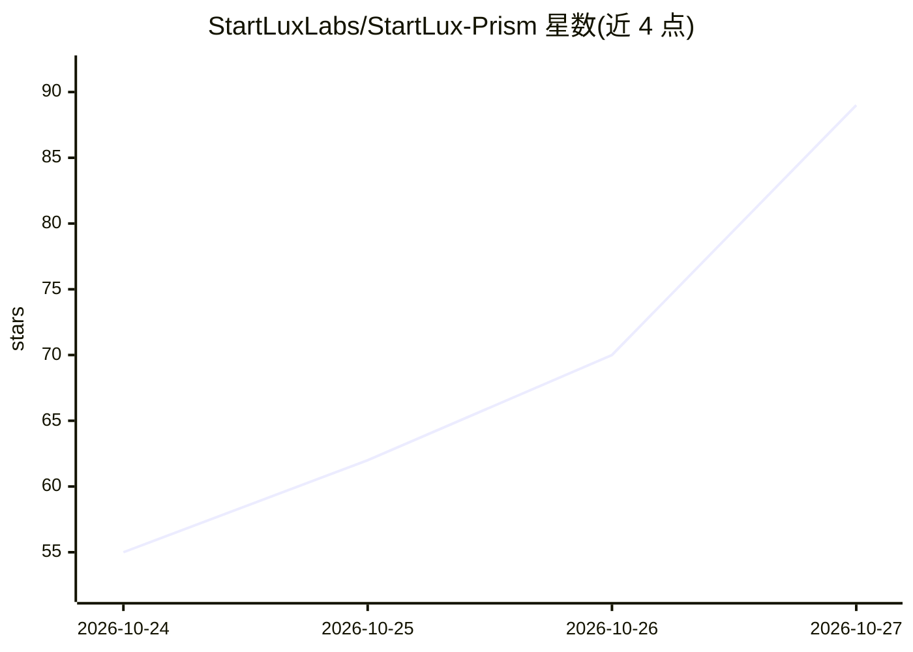

# StartLuxLabs/StartLux-Prism

⭐ 89 · Python · 推送 2026-10-26 · [GitHub](https://github.com/StartLuxLabs/StartLux-Prism) · [官网](https://huggingface.co/startlux-models) · 组织维护

**StartLux-Decision 决策模型的 GPU 推理服务器：直接运行 GGUF 文件**

面向 StartLux-Decision v1 与 v1.1 AutoThink（4B/9B/27B）的专用推理引擎：直接读取官方发布的 GGUF 文件（Q8_0 以 int8/W8A8、Q4_K_M 以 W4A8 运行，无需转换），通过 /v1/systemone API 提供选项概率、none_probability、思考链与图像输入。支持 Ampere 至 Blackwell 的 NVIDIA GPU，提供数据并行与张量并行（2 或 4 卡），int8 GEMM 在 int32 中精确求和以实现跨 GPU 与批次的位级可复现输出。CUDA 内核在首次启动时编译。限制：仅支持该系列模型；服务器自身无鉴权；模型权重为 CC BY-NC 4.0 非商用许可。

## 筛选速览

| 维度 | 判定 | 备注 |
|---|---|---|
| AI 角色 | `ai-ecosystem` | LLM/agent 周边工具 |
| 许可风险 | `none` | — |
| 部署形态 | `library` | 以包/库形式分发 |
| 模型依赖 | — | README 未给出锁定关系 |
| 硬件要求 | — | 无带数字的原话,不猜 |
| 安装摩擦 | `medium` | 含编译或系统依赖之一 |
| 成熟度 | — | 结构信号不足 |

## 能力要点

- 直接运行发布的 GGUF 文件（Q8_0→int8、Q4_K_M→W4A8），无转换步骤
- int8 结果跨 GPU 数量与批次位级一致
- 数据并行与张量并行（--tp 2/4），4-bit 下 27B 可跑在单张 32GB RTX 5090
- 单请求最多 8 张图像与 AutoThink 思考链 GPU 解码

## 适用场景

- 在自有 NVIDIA GPU 上低延迟部署 StartLux-Decision 决策模型
- 对工单分类、意图判定等结构化问题批量取概率输出
- 多卡扩展决策服务的吞吐或降低延迟

## 场景标签

`推理引擎` · 领域:训练与推理

## 证据(README 行号)

> L3: **Fast, exact inference for StartLux-Decision models on NVIDIA
> L91: python -m startlux_prism.server --gguf $G --model-dir $M --port 8092    # ready when it prints "Ready"
> L211: The 27B on one H200 per server, against the official engine (Startlux-decide-inference on vLLM 0.31) on the same

## 星数曲线

2026-10-24 55 → 2026-10-27 89（+34）

---
*卡片 v1 · prompt 1.4 · 生成 2026-10-24 · 置信度 mid · 依据 README sha `ff74c31a4ed5` · [字段定义](../../DATASET.md)*
