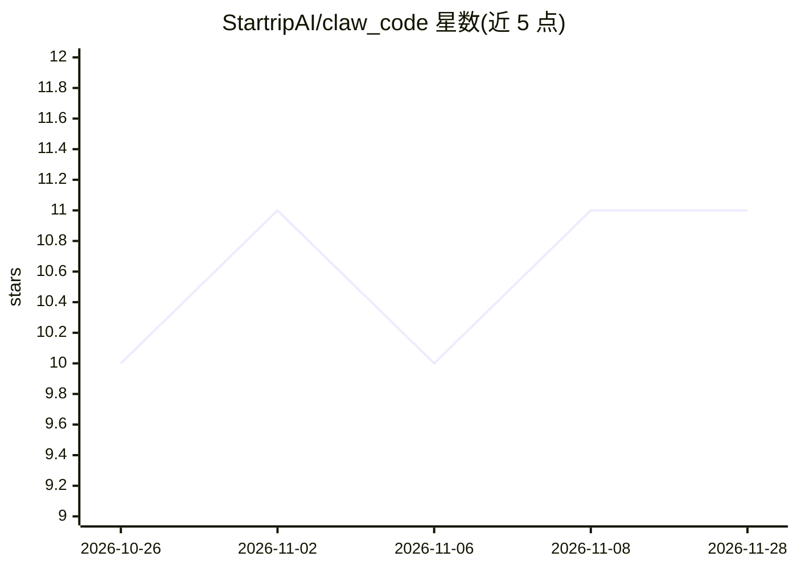

# StartripAI/claw_code

⭐ 11 · Rust · MIT · 推送 2026-04-03 · [GitHub](https://github.com/StartripAI/claw_code) · 个人维护

**Claude Code 的 Rust 重写版命令行编码助手**

以 Rust 重写的命令行 agentic 编码助手，定位为 Claude Code 的替代实现。提供 42 个内置工具（文件读写编辑、grep、bash、网页抓取、子任务 agent 等）、原生 JSON 工具调用、25 个 slash 命令、会话持久化与自动上下文压缩、三级权限沙箱。支持多 provider：Anthropic、OpenAI 兼容端点及离线 Mock，可在会话中热切换。通过自动兼容性测试套件对照上游参考实现打分。需从源码用 cargo 构建。

## 筛选速览

| 维度 | 判定 | 备注 |
|---|---|---|
| AI 角色 | `ai-native` | 本体是模型或模型工具 |
| 许可风险 | `permissive` | MIT |
| 部署形态 | `None` |  |
| 模型依赖 | locked-api |  |
| 硬件要求 | — | 无带数字的原话,不猜 |
| 安装摩擦 | `low` | 无编译、无系统依赖或容器化 |
| 成熟度 | — | 结构信号不足 |

## 能力要点

- 42 个内置工具的 agentic 编码循环
- Anthropic 与 OpenAI 兼容端点多 provider 支持，可中途热切换
- 三级权限沙箱与工具前后钩子拦截机制
- 内置兼容性测试套件对照上游参考实现评分

## 适用场景

- 在终端里以对话方式让 agent 读写和修改代码
- 使用 OpenAI 兼容端点或离线 Mock 运行编码助手
- 需要 Rust 实现的 Claude Code 替代版本

## 场景标签

`编码 Agent` · 领域:编码与开发

## 证据(README 行号)

> L4:  Drop-in agentic coding assistant. Native tool calling. Multi-provider. Zero compromises.
> L22: That's it. ClawCode auto-detects your provider, spins up a session, and drops you into an agentic coding loop with 

## 星数曲线

2026-10-26 10 → 2026-11-28 11（+1）

---
*卡片 v1 · prompt 1.4 · 生成 2026-11-18 · 置信度 high · 依据 README sha `fffcff1d1f62` · [字段定义](../../DATASET.md)*
