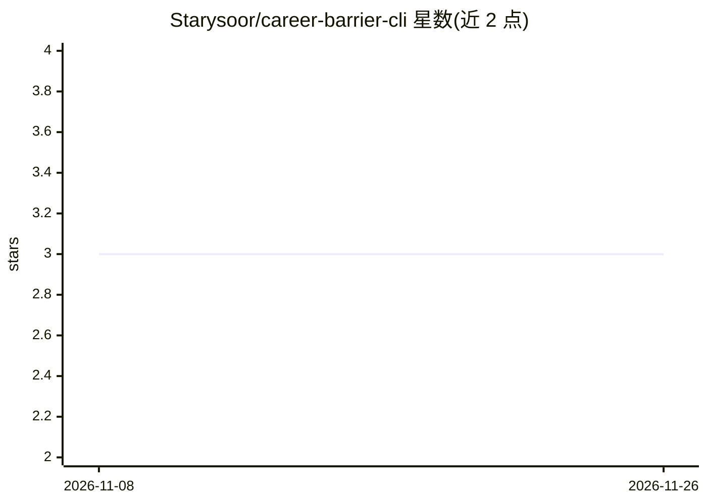

# Starysoor/career-barrier-cli

⭐ 3 · Python · MIT · 推送 2026-11-24 · [GitHub](https://github.com/Starysoor/career-barrier-cli) · 个人维护 · 中文 README

**为职规大赛学生自动完成生涯闯关答题的 CLI**

非官方第三方自动化命令行工具，依次完成平台 8 个可提交关卡并回读服务端校验结果。答案模式三种：内置模板、AI 生成、快速随机；AI 模式调用任意 OpenAI 兼容接口生成答题文本、PDF 段落正文及职业榜样等个性化字段，失败自动回退模板。Python 标准库实现单文件零依赖，运行前需本机装有 Edge 或 Chrome 以获取登录态，README 声明仅供学习交流、不得正式参赛。

## 筛选速览

| 维度 | 判定 | 备注 |
|---|---|---|
| AI 角色 | `ai-native` | 本体是模型或模型工具 |
| 许可风险 | `permissive` | MIT |
| 部署形态 | `None` |  |
| 模型依赖 | local-ok | 支持本地模型 |
| 硬件要求 | — | 无带数字的原话,不猜 |
| 安装摩擦 | `low` | 无编译、无系统依赖或容器化 |
| 成熟度 | — | 结构信号不足 |

## 能力要点

- 一键完成 8 个关卡，支持续跑与覆盖重刷
- 三种答案模式：内置模板 / AI 生成 / 快速随机
- 内置 PDF 排版引擎生成招聘简章、访谈报告等附件
- 运行结束打印真实内容来源统计

## 适用场景

- 完成学校布置的生涯闯关练习任务
- 用 AI 按专业批量生成答题内容与 PDF 报告
- 多账号切换管理与进度核对

## 场景标签

`工作流自动化` `AI 写作` · 领域:效率与自动化

## 证据(README 行号)

> L22: |三种答案模式|内置模板 / AI 生成（任意 OpenAI 兼容接口）/ 快速随机|
> L89: - **AI 模式**：全部答题文本 + 5 份 PDF 段落正文 + 职业榜样 + 目标职业 + 意向职业 +

## 星数曲线

2026-11-08 3 → 2026-11-26 3（+0）

---
*卡片 v1 · prompt 1.4 · 生成 2026-11-22 · 置信度 high · 依据 README sha `1a55aa55007d` · [字段定义](../../DATASET.md)*
