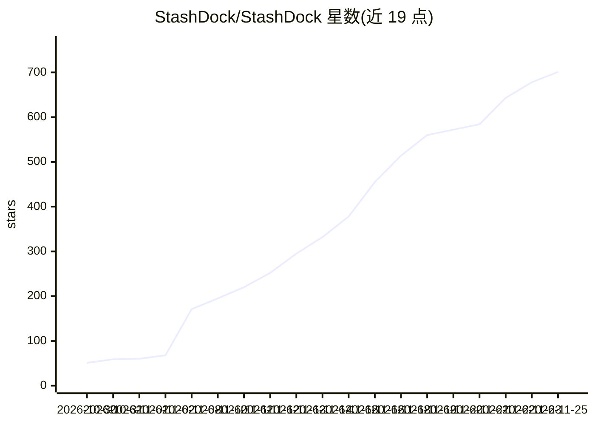

# StashDock/StashDock

⭐ 701 · HTML · AGPL-3.0 · 推送 2026-11-13 · [GitHub](https://github.com/StashDock/StashDock) · [官网](https://stashdock.app) · 个人维护 · 中文 README

**本地优先的个人上下文库：为 AI 对话收集复用引用**

StashDock 是运行在用户电脑上的可视化上下文库，把网页链接、本地文件、提示词/规则统一存储，通过卡片视图、快速搜索、收藏与标签管理，并支持复制或拖拽到任意 AI 对话中。提供 Windows/macOS 桌面应用、ChatGPT 侧边栏插件、DeepSeek Harness 插件与 Chrome 捕获扩展；通过 MCP 协议和 Skill 暴露引用检索、保存与标签整理工具。数据存储在本地设备，多设备间不自动同步，AGPL v3 许可。

## 筛选速览

| 维度 | 判定 | 备注 |
|---|---|---|
| AI 角色 | `ai-enhanced` | 去掉 AI 部分产品仍成立 |
| 许可风险 | `viral` | AGPL-3.0 |
| 部署形态 | `None` |  |
| 模型依赖 | locked-api |  |
| 硬件要求 | — | 无带数字的原话,不猜 |
| 安装摩擦 | `low` | 无编译、无系统依赖或容器化 |
| 成熟度 | — | 结构信号不足 |

## 能力要点

- 本地存储引用（链接/文件/笔记），SQLite FTS5 全文检索
- 通过 MCP 与 Skill 向 AI 暴露引用检索、保存与标签整理工具
- 桌面端与 ChatGPT/DeepSeek Harness 插件共享同一本地库
- Chrome 扩展捕获页面链接、可读内容与封面

## 适用场景

- 把散落在书签、文件夹和历史对话里的素材集中复用到 AI 对话
- 为项目维护可跨任务复用的参考资料库
- 浏览时一键保存页面供后续 AI 会话使用

## 场景标签

`提示工程` `知识库管理` · 领域:Agent 开发

## 证据(README 行号)

> L29: StashDock brings that context into one personal library on your computer.
> L76: StashDock exposes library tools through the Model Context Protocol (MCP) and
> L110: References are stored on the local device. Desktop and the AI plugins

## 星数曲线

2026-10-30 51 → 2026-11-25 701（+650）

---
*卡片 v1 · prompt 1.4 · 生成 2026-11-24 · 置信度 high · 依据 README sha `68fde965906e` · [字段定义](../../DATASET.md)*
