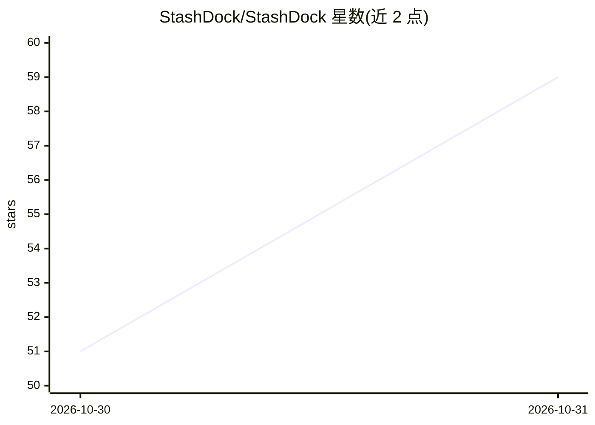

# StashDock/StashDock

⭐ 59 · HTML · MIT · 推送 2026-10-29 · [GitHub](https://github.com/StashDock/StashDock) · [官网](https://stashdock.app) · 组织维护 · 中文 README

**本地优先的个人上下文库：收集、组织并在 AI 对话中复用资料**

面向 AI 使用者的桌面端个人上下文库：通过 Chrome 扩展保存网页、导入书签或添加本地文件、笔记、提示词与规则，用标签组织并可编辑交给 AI 的上下文。提供 Windows/macOS 安装包与 ChatGPT 插件，插件在聊天侧边栏中把选中的参考资料加入对话；亦可通过拖拽或复制用于任意 AI 应用。内置 MCP 及技能，AI 可检索库中资料、保存新学到的规则到库中。数据存储在本机，不做自动跨设备同步；安装包未签名、Mac 应用未公证。

## 筛选速览

| 维度 | 判定 | 备注 |
|---|---|---|
| AI 角色 | `ai-native` | 本体是模型或模型工具 |
| 许可风险 | `permissive` | MIT |
| 部署形态 | `None` |  |
| 模型依赖 | — | README 未给出锁定关系 |
| 硬件要求 | — | 无带数字的原话,不猜 |
| 安装摩擦 | `low` | 无编译、无系统依赖或容器化 |
| 成熟度 | — | 结构信号不足 |

## 能力要点

- Chrome 扩展保存网页、导入书签、添加本地文件与提示词规则
- ChatGPT 插件在对话侧边栏中将选中参考资料加入聊天
- MCP 与内置技能：AI 可检索、保存、整理库中上下文
- 本地存储，安装 Desktop 与插件共享同一库

## 适用场景

- 把散落在浏览器标签和文件夹里的参考资料集中成可检索的库
- 在 ChatGPT 对话中直接引用自己保存的资料
- 让 AI 把对话中确定的写作规则保存为可复用条目

## 场景标签

`知识库管理` `提示工程` · 领域:Agent 开发

## 证据(README 行号)

> L7:  An AI-native, local personal context library.
> L44: Through MCP and its included skill, StashDock gives AI a useful role on both

## 星数曲线

2026-10-30 51 → 2026-10-31 59（+8）

---
*卡片 v1 · prompt 1.4 · 生成 2026-10-30 · 置信度 high · 依据 README sha `2fb7cca29117` · [字段定义](../../DATASET.md)*
