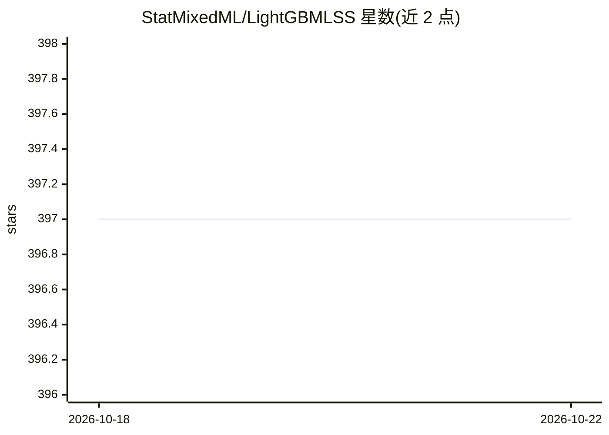

# StatMixedML/LightGBMLSS

⭐ 397 · Python · Apache-2.0 · 推送 2026-10-02 · [GitHub](https://github.com/StatMixedML/LightGBMLSS) · [官网](https://statmixedml.github.io/LightGBMLSS/) · 个人维护

**LightGBM 的概率建模扩展：预测完整条件分布**

在 LightGBM 梯度提升基础上扩展为分布式回归（GAMLSS 型）框架，对一元目标变量建模并预测完整条件分布，从中导出预测区间与分位数。支持连续、离散及混合离散-连续分布，含 Normalizing Flows、Mixture-Densities、零膨胀/零调整分布；基于 PyTorch/Pyro 自动推导各分布参数的梯度与 Hessian，集成 Optuna 自动超参搜索与 SHAP 输出解释。以 Python 包发布于 PyPI，兼容 LightGBM 全部功能，适用于需要不确定性量化的回归与预测任务。

## 筛选速览

| 维度 | 判定 | 备注 |
|---|---|---|
| AI 角色 | `ai-native` | 本体是模型或模型工具 |
| 许可风险 | `permissive` | Apache-2.0 |
| 部署形态 | `library` | 以包/库形式分发 |
| 模型依赖 | — | README 未给出锁定关系 |
| 硬件要求 | — | 无带数字的原话,不猜 |
| 安装摩擦 | `low` | 无编译、无系统依赖或容器化 |
| 成熟度 | — | 结构信号不足 |

## 能力要点

- 建模并预测目标的完整条件分布，导出预测区间与分位数
- Normalizing Flows 与 Mixture-Densities 支持多模态复杂分布
- PyTorch 自动推导各分布参数的梯度与 Hessian
- Optuna 自动超参搜索（含剪枝）与 SHAP 输出解释

## 适用场景

- 为回归任务输出预测区间而非单点预测
- 建模含大量零值或多模态分布的目标变量
- 量化机器学习预测的不确定性

## 场景标签

 · 领域:机器学习/概率建模

## 证据(README 行号)

> L12: We introduce a comprehensive framework that models and predicts the full conditional distribution of a univariate t
> L50: Our framework is built upon PyTorch and Pyro, enabling users to harness a diverse set of distributional families. L

## 星数曲线

2026-10-18 397 → 2026-10-22 397（+0）

---
*卡片 v1 · prompt 1.4 · 生成 2026-10-22 · 置信度 high · 依据 README sha `a0b6335dc55b` · [字段定义](../../DATASET.md)*
