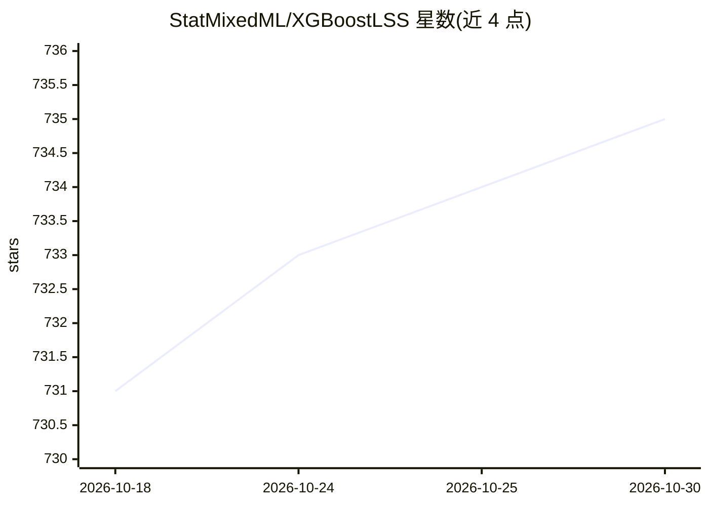

# StatMixedML/XGBoostLSS

⭐ 735 · Python · Apache-2.0 · 推送 2026-10-02 · [GitHub](https://github.com/StatMixedML/XGBoostLSS) · [官网](https://statmixedml.github.io/XGBoostLSS/) · 个人维护

**XGBoost 的概率建模扩展：预测完整条件分布**

基于 PyTorch 和 Pyro 构建的 Python 框架，将 XGBoost 扩展为分布回归：建模单变量与多变量目标的完整条件分布，支持连续、离散及混合离散-连续分布，可从分布导出预测区间与分位数。特性包括 Normalizing Flows 处理多峰分布、Mixture-Densities、多目标回归、零膨胀/零调整分布、基于 PyTorch 的梯度与 Hessian 自动推导、Optuna 自动超参搜索（含剪枝）及 SHAP 输出解释。兼容 XGBoost 全部功能，通过 pip 安装，附论文引用。

## 筛选速览

| 维度 | 判定 | 备注 |
|---|---|---|
| AI 角色 | `ai-native` | 本体是模型或模型工具 |
| 许可风险 | `permissive` | Apache-2.0 |
| 部署形态 | `library` | 以包/库形式分发 |
| 模型依赖 | — | README 未给出锁定关系 |
| 硬件要求 | — | 无带数字的原话,不猜 |
| 安装摩擦 | `low` | 无编译、无系统依赖或容器化 |
| 成熟度 | — | 结构信号不足 |

## 能力要点

- 建模完整条件分布并导出预测区间与分位数
- Normalizing Flows 与 Mixture-Densities 处理复杂/多峰分布
- 多目标回归与零膨胀/零调整分布支持
- PyTorch 自动推导梯度与 Hessian，Optuna 自动超参搜索
- SHAP 解释输出，兼容 XGBoost 全部功能

## 适用场景

- 需要预测区间与不确定性量化的回归任务
- 多峰或含大量零值数据的分布建模
- 多变量目标及其依赖关系的联合建模

## 场景标签

 · 领域:机器学习/统计建模

## 证据(README 行号)

> L11: # XGBoostLSS - An extension of XGBoost to probabilistic modelling
> L12: We introduce a comprehensive framework that models and predicts the full conditional distribution of univariate and

## 星数曲线

2026-10-18 731 → 2026-10-30 735（+4）

---
*卡片 v1 · prompt 1.4 · 生成 2026-10-21 · 置信度 high · 依据 README sha `129a8d1c4a8e` · [字段定义](../../DATASET.md)*
