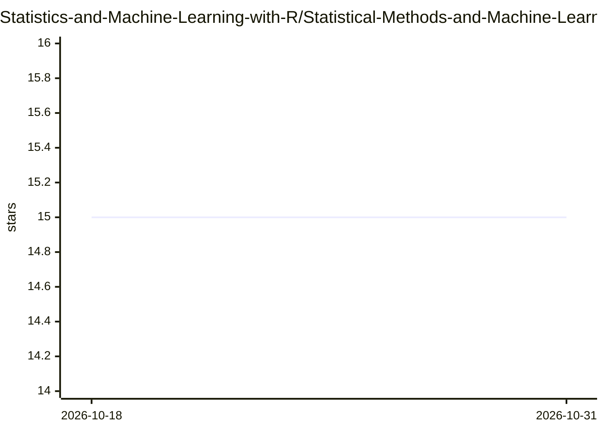

# Statistics-and-Machine-Learning-with-R/Statistical-Methods-and-Machine-Learning-in-R

⭐ 15 · R · 推送 2025-11-05 · [GitHub](https://github.com/Statistics-and-Machine-Learning-with-R/Statistical-Methods-and-Machine-Learning-in-R) · 组织维护

**面向生信学生的统计学与机器学习 R 教程仓库（脚本+理论+讲义）**

面向计算机背景薄弱、尤其是生物信息学方向学生的学习指南：提供用 R 编写的统计分析与机器学习脚本（含对应数据集 csv 与说明文件），覆盖显著性检验、聚类、排序（PCA/PCoA/NMDS 等）、决策树与人工神经网络。脚本针对行列转置的生信数据格式编写。另配套理论概念章节与带练习的讲义+教程包，教程文件需邮件索取密码获取。内容开放供学习、教学与再创作使用。

## 筛选速览

| 维度 | 判定 | 备注 |
|---|---|---|
| AI 角色 | `ai-knowledge` | 知识聚合/清单类 |
| 许可风险 | `none` | — |
| 部署形态 | `None` |  |
| 模型依赖 | — | README 未给出锁定关系 |
| 硬件要求 | — | 无带数字的原话,不猜 |
| 安装摩擦 | `low` | 无编译、无系统依赖或容器化 |
| 成熟度 | — | 结构信号不足 |

## 能力要点

- R 脚本配套数据集 csv 与 Read_me 说明，覆盖显著性检验、聚类、排序、决策树、人工神经网络
- 脚本适配生信数据常见格式（列为实例、行为变量）
- 提供理论概念章节与带练习任务的讲义+教程包
- 配套 wiki 与网站（mpa.ovgu.de）呈现结果图像

## 适用场景

- 零基础学生系统学习统计学到机器学习的路径
- 生信课程中直接运行带注释的 R 分析脚本
- 教学者引用或改编开源教学内容

## 场景标签

`教程课程` · 领域:学习与行业

## 证据(README 行号)

> L5: This repo has been created and organized to work as a mini guide for students with none or very little background in
> L6: Bio-Informatics, to have a general idea and understand the underlying concepts of Statistics paving its way towards 
> L54: We have also created a series of presentations & R Scripts which can act as a complete tutorial for an individual o

## 星数曲线

2026-10-18 15 → 2026-10-31 15（+0）

---
*卡片 v1 · prompt 1.4 · 生成 2026-10-30 · 置信度 high · 依据 README sha `e170118a6c34` · [字段定义](../../DATASET.md)*
