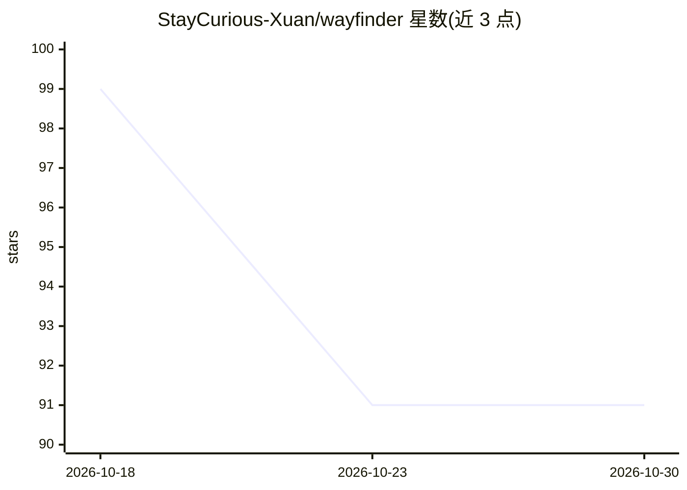

# StayCurious-Xuan/wayfinder

⭐ 91 · JavaScript · MIT · 推送 2026-10-18 · [GitHub](https://github.com/StayCurious-Xuan/wayfinder) · [官网](https://wayfinder-ai.pages.dev) · 个人维护

**本地优先桌面应用：把 AI 协作过程可视化为目标与分支的历史图谱**

面向使用 AI 编程/研究/写作工具的项目工作者的桌面应用：从 Codex 与 Claude Code 的会话历史中收集数据，在本地把目标、尝试、失败分支、决策与文件变更组织成项目级『voyage』可视化历史，支持文件变更回放与来源关联细节。数据存储于 ~/.wayfinder，无账号、无遥测、无云同步。当前为 early access，数据格式与分组行为可能变化；macOS/Windows 提供未签名的安装包。

## 筛选速览

| 维度 | 判定 | 备注 |
|---|---|---|
| AI 角色 | `ai-knowledge` | 知识聚合/清单类 |
| 许可风险 | `permissive` | MIT |
| 部署形态 | `None` |  |
| 模型依赖 | — | README 未给出锁定关系 |
| 硬件要求 | — | 无带数字的原话,不猜 |
| 安装摩擦 | `low` | 无编译、无系统依赖或容器化 |
| 成熟度 | `idea` | |

## 能力要点

- 从 Codex 与 Claude Code 会话历史收集数据，本地归一化存储
- 项目级 voyage 分组，保留失败分支与来源关联细节
- 会话含编辑时提供真实文件变更回放
- 本地优先：无账号、无遥测、无云同步

## 适用场景

- 回顾与 AI 协作项目中哪些方案成功、哪些失败及原因
- 跨 AI 工具在一张项目地图上查看同一项目的演进
- 在无云端环境下留存 AI 协作过程的完整历史

## 场景标签

`知识库管理` · 领域:知识与检索

## 证据(README 行号)

> L7: Wayfinder is a local-first desktop app that turns work with AI into a visual
> L13: design, and other project work. The current early-access collectors support
> L60: - Codex session history

## 星数曲线

2026-10-18 99 → 2026-10-30 91（-8）

---
*卡片 v1 · prompt 1.4 · 生成 2026-10-23 · 置信度 high · 依据 README sha `abc0090df5a3` · [字段定义](../../DATASET.md)*
