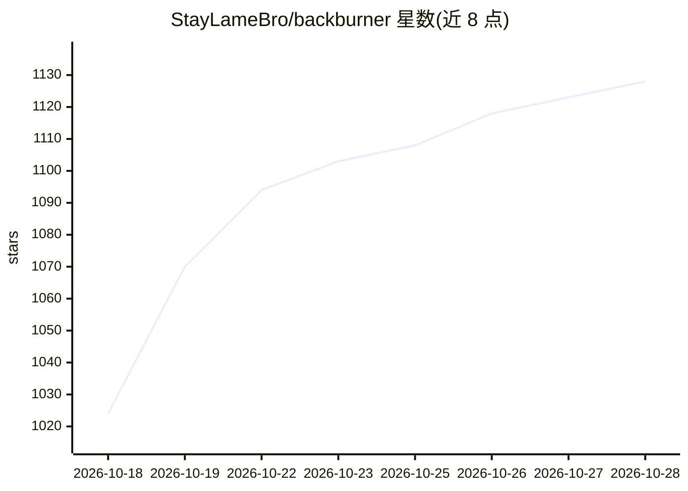

# StayLameBro/backburner

⭐ 1,133 · Python · MIT · 推送 2026-10-27 · [GitHub](https://github.com/StayLameBro/backburner) · 组织维护

**iPhone 经 USB-C 协助 Mac 本地跑 27B 模型：更快预填充与更长上下文**

llama.cpp 的分支推理引擎：将 iPhone/iPad 经 10 Gb/s USB-C 接入 Mac，预填充阶段按层切分（Mac 跑前 40 层、手机跑其余层），64k 以上上下文时由手机 GPU 与 Neural Engine 承担旧 KV 键的注意力计算，从而在 24 GB Mac 上支撑最高 196k-229k 的 8-bit 上下文（实测到 128k）。附带自研 Mac 内核（SME2、Metal 融合、DFlash2 推测解码）与 SSD 提示缓存代理。面向在 Apple 设备上本地运行超出单机容量模型的开发者和高级用户；限制包括小读取不启用手机、64k 以下解码速度不受益、读取中需保持手机应用前台。

## 筛选速览

| 维度 | 判定 | 备注 |
|---|---|---|
| AI 角色 | `ai-ecosystem` | LLM/agent 周边工具 |
| 许可风险 | `permissive` | MIT |
| 部署形态 | `None` |  |
| 模型依赖 | — | README 未给出锁定关系 |
| 硬件要求 | — | 无带数字的原话,不猜 |
| 安装摩擦 | `low` | 无编译、无系统依赖或容器化 |
| 成熟度 | — | 结构信号不足 |

## 能力要点

- 按层切分的流水线预填充：16k-48k 场景快 29-44%
- 手机持有的旧 KV 页注意力（GPU + Neural Engine），8-bit 上下文实测到 128k
- 贪心输出在有无手机时逐 token 一致（256/256）
- 自研 SME2、Metal 融合与 DFlash2 无损推测解码内核

## 适用场景

- 24 GB Mac 本地跑 Qwen3.8-27B 并获得更长上下文
- Agent 频繁读取大文件/工具结果时缩短等待
- 用 iPhone/iPad 作为第二台推理设备扩展单机放不下的模型

## 场景标签

`推理引擎` · 领域:训练与推理

## 证据(README 行号)

> L13: The engine is a llama.cpp fork (`llama.cpp/`, StayLameBro/backburner-llama.cpp)
> L135: - **Split prefill** (`llama.cpp/src/llama-split.cpp`; the phone's tail server is in `ios/Backburner`). The Mac run

## 星数曲线

2026-10-18 1,024 → 2026-10-28 1,128（+104）

---
*卡片 v1 · prompt 1.4 · 生成 2026-10-21 · 置信度 high · 依据 README sha `92aa732acf88` · [字段定义](../../DATASET.md)*
