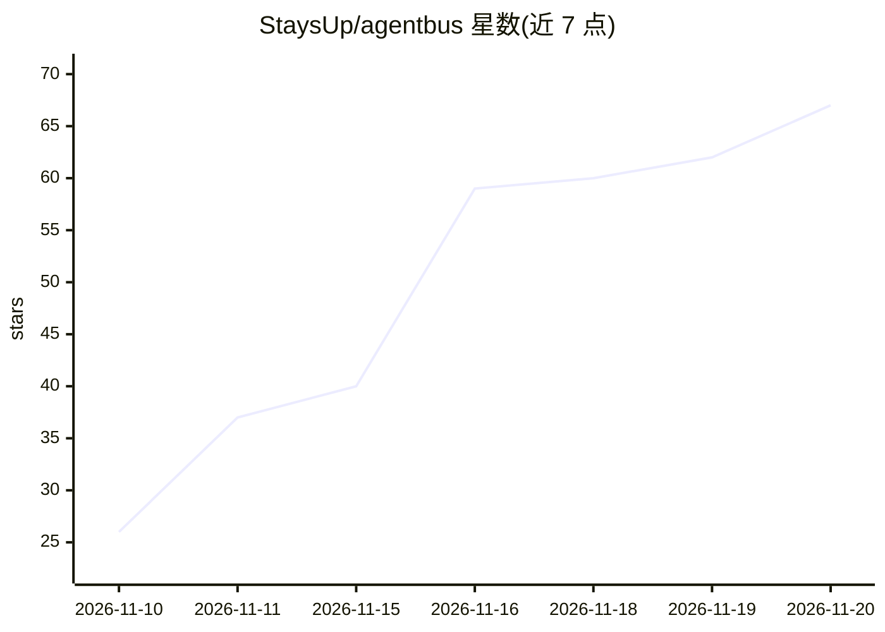

# StaysUp/agentbus

⭐ 67 · Go · NOASSERTION · 推送 2026-11-19 · [GitHub](https://github.com/StaysUp/agentbus) · [官网](https://agentbus.art) · 个人维护

**跨厂商编码 agent 网关：统一运行并记录每次模型调用**

位于编码 agent 与模型厂商之间的 Go 中间件：可运行 Claude Code、Codex、Antigravity 或任意 OpenRouter 模型，允许同一会话内让不同 agent 互相提问或协作；记录每一轮对话、每次模型调用的完整输入输出与成本。每个会话在文件夹的独立副本中工作，支持沙箱与网络白名单隔离；数据与密钥保存在本机。通过安装脚本、Homebrew 或 go install 安装，自带 cockpit Web 界面。已知限制包括 Ubuntu 24.04 沙箱需 AppArmor 配置、ext4 下为全量拷贝等。

## 筛选速览

| 维度 | 判定 | 备注 |
|---|---|---|
| AI 角色 | `ai-ecosystem` | LLM/agent 周边工具 |
| 许可风险 | `none` | NOASSERTION |
| 部署形态 | `library` | 以包/库形式分发 |
| 模型依赖 | — | README 未给出锁定关系 |
| 硬件要求 | — | 无带数字的原话,不猜 |
| 安装摩擦 | `low` | 无编译、无系统依赖或容器化 |
| 成熟度 | — | 结构信号不足 |

## 能力要点

- 同一会话内让不同厂商 agent 互相提问与协作
- 记录每次模型调用的完整内容与成本
- 每会话独立文件夹副本，沙箱与网络白名单隔离可选
- API key 仅注入对应厂商调用，不展示给 agent

## 适用场景

- 让 Claude Code 与 Codex 在同一会话中互相审查代码
- 统一观测多个编码 agent 的模型调用与花费
- 隔离环境中运行 agent 并人工审阅后应用改动

## 场景标签

`编码 Agent` `LLM 可观测性` `多智能体` · 领域:Agent 开发

## 证据(README 行号)

> L13: AgentBus sits between your coding agents and every model vendor. It runs the agents you already
> L18: - **You see every model call**, and what it cost: exactly what each model was sent, piece by piece,

## 星数曲线

2026-11-10 26 → 2026-11-20 67（+41）

---
*卡片 v1 · prompt 1.4 · 生成 2026-11-18 · 置信度 high · 依据 README sha `511fdde1b17f` · [字段定义](../../DATASET.md)*
