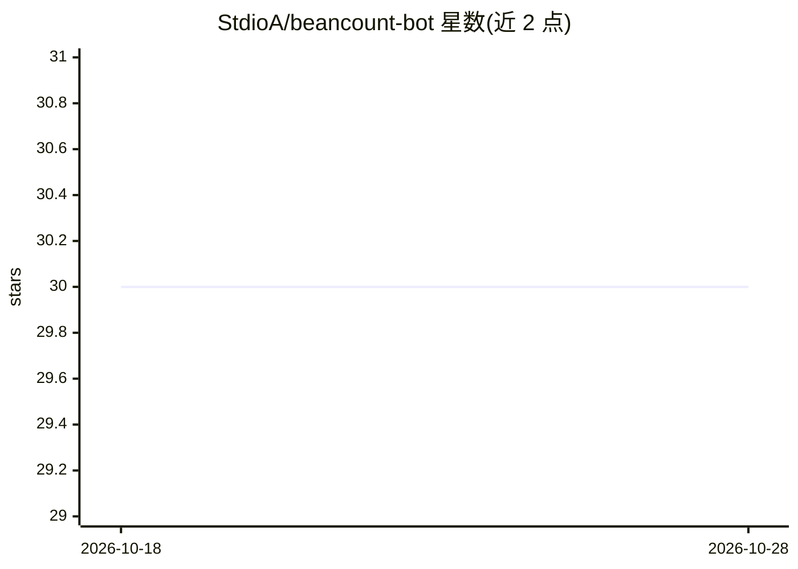

# StdioA/beancount-bot

⭐ 30 · Python · 推送 2026-05-19 · [GitHub](https://github.com/StdioA/beancount-bot) · 个人维护 · 中文 README

**通过 IM 快速记录 beancount 记账的 RAG 机器人**

面向个人记账用户的 Telegram/Mattermost/Web 机器人，用于以少量文字快速记录 beancount 交易。支持基本语法匹配（金额、账户、payee、narration、标签），同一 payee 可省略对方账户；匹配失败时从向量数据库中找最相近的既有记录补全，或经 RAG 补全交易细节，输出供用户确认。向量存储可用 sqlite-vec，未安装时回退为 json 存储+numpy 计算。另提供区间支出统计、账户变动统计、克隆交易等命令。

## 筛选速览

| 维度 | 判定 | 备注 |
|---|---|---|
| AI 角色 | `ai-enhanced` | 去掉 AI 部分产品仍成立 |
| 许可风险 | `none` | — |
| 部署形态 | `self-host` | docker 或自建部署 |
| 模型依赖 | — | README 未给出锁定关系 |
| 硬件要求 | — | 无带数字的原话,不猜 |
| 安装摩擦 | `low` | 无编译、无系统依赖或容器化 |
| 成熟度 | — | 结构信号不足 |

## 能力要点

- 基本语法匹配与 payee 记忆简化输入
- 匹配失败时从向量数据库/RAG 补全交易信息
- 支持 Telegram/Mattermost/Web 三种前端
- /expense、/bill 区间统计与 /clone 复制交易

## 适用场景

- 在 IM 中用几个词快速记一笔账
- 查询某月支出与账户变动
- 复用历史交易快速生成当日记录

## 场景标签

`聊天机器人` `RAG` · 领域:对话与助手

## 证据(README 行号)

> L8: A Beancount bot that allows for quick manual recording of simple transactions via IM software.
> L14:  * After matching failure, it can attempt record matching from a vector database or complete information through RA

## 星数曲线

2026-10-18 30 → 2026-10-28 30（+0）

---
*卡片 v1 · prompt 1.4 · 生成 2026-10-26 · 置信度 high · 依据 README sha `c51f5302a2e7` · [字段定义](../../DATASET.md)*
