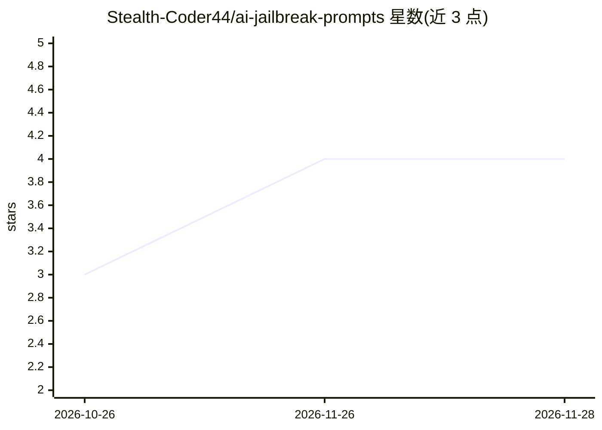

# Stealth-Coder44/ai-jailbreak-prompts

⭐ 4 · 推送 2026-10-22 · [GitHub](https://github.com/Stealth-Coder44/ai-jailbreak-prompts) · [官网](https://discord.gg/sSZA24P8Ek) · 个人维护

**面向 ChatGPT/Claude 等多模型的越狱提示词收集社区**

4Jailbreaks 是由 4479 创建的 AI 提示工程与越狱研究社区，通过 Discord 分享覆盖 ChatGPT、Claude、Gemini、Grok、DeepSeek、Qwen 等模型的越狱提示词集合与研究内容。README 列出可获取的资源类型：提示词集合、提示工程技术、多模型讨论、新发布提示词与社区投稿内容，设有免费与付费社区分区，并声明独立于各 AI 提供商。本仓库本身不提供代码或安装途径，主要为社区导流页面。

## 筛选速览

| 维度 | 判定 | 备注 |
|---|---|---|
| AI 角色 | `ai-knowledge` | 知识聚合/清单类 |
| 许可风险 | `none` | — |
| 部署形态 | `None` |  |
| 模型依赖 | — | README 未给出锁定关系 |
| 硬件要求 | — | 无带数字的原话,不猜 |
| 安装摩擦 | `low` | 无编译、无系统依赖或容器化 |
| 成熟度 | — | 结构信号不足 |

## 能力要点

- 覆盖 ChatGPT、Claude、Gemini、Grok、DeepSeek、Qwen 等多模型的提示词集合
- 通过 Discord 社区分发新发布与社区投稿的提示词
- 含提示工程技术与 LLM 行为研究讨论

## 适用场景

- 查找针对不同 LLM 的越狱提示词集合
- 参与 AI 提示工程与模型行为的社区讨论
- 获取社区新发布的提示词更新

## 场景标签

`提示工程` · 领域:Agent 开发

## 证据(README 行号)

> L7: Explore a community dedicated to AI jailbreak prompts, creative prompting, LLM behavior, and prompt engineering acro
> L29: - 🔓 AI jailbreak prompt collections

## 星数曲线

2026-10-26 3 → 2026-11-28 4（+1）

---
*卡片 v1 · prompt 1.4 · 生成 2026-11-22 · 置信度 high · 依据 README sha `0a4be3c17208` · [字段定义](../../DATASET.md)*
