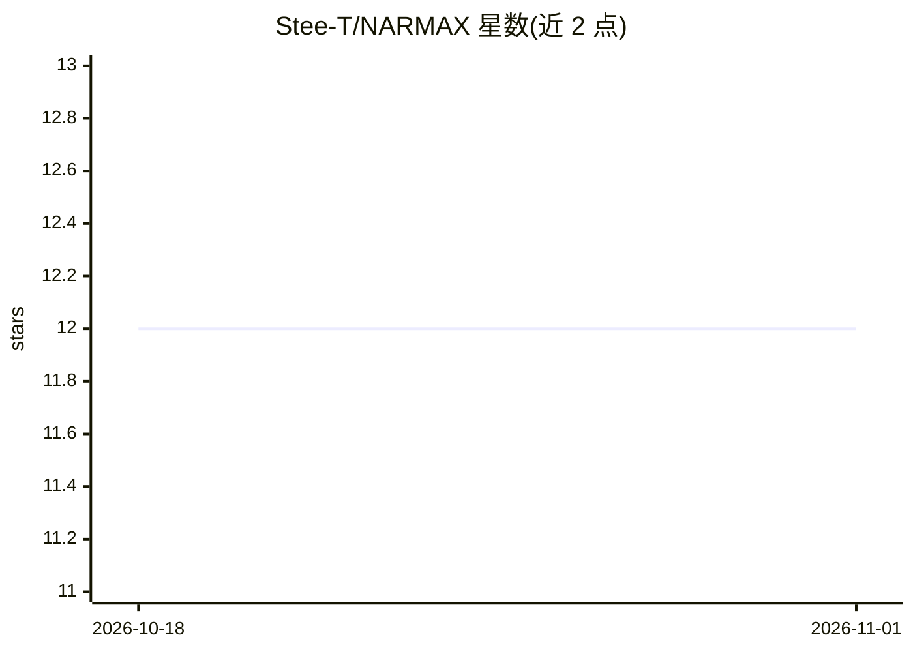

# Stee-T/NARMAX

⭐ 12 · Python · BSD-3-Clause · 推送 2026-07-20 · [GitHub](https://github.com/Stee-T/NARMAX) · 个人维护

**面向科研的 NARMAX 符号拟合机器学习库**

Python 库，用作者论文中的 rFOrLSR/AOrLSR 等算法对用户提供的任意回归项字典做稀疏最小二乘拟合，得到 NARMAX 代数表达式形式的符号模型，支持非线性、自回归、滑动平均与外生输入项的任意组合，也支持 MIMO/MISO、RBF、小波、多项式等展开。基于 PyTorch 矩阵（GPU 加速标签），通过 git clone 后 pip 本地安装。提供论文示例与教程，面向系统辨识、物理/生物/工程建模等需要可解释符号方程的场景。

## 筛选速览

| 维度 | 判定 | 备注 |
|---|---|---|
| AI 角色 | `ai-native` | 本体是模型或模型工具 |
| 许可风险 | `permissive` | BSD-3-Clause |
| 部署形态 | `library` | 以包/库形式分发 |
| 模型依赖 | — | README 未给出锁定关系 |
| 硬件要求 | — | 无带数字的原话,不猜 |
| 安装摩擦 | `low` | 无编译、无系统依赖或容器化 |
| 成熟度 | `idea` | |

## 能力要点

- rFOrLSR/AOrLSR 稀疏最小二乘拟合，输出 NARMAX 符号表达式
- 任意展开类型与混合展开（FIR/IIR/RBF/小波/多项式等）
- 支持 MIMO/MISO 任意输入输出维度
- MA 噪声项建模用于稳定估计

## 适用场景

- 为动态系统辨识拟合可解释的符号方程
- 数据稀缺或需要实时更新模型时用符号模型替代黑箱网络
- 利用先验知识约束模型结构（如已知线性或振荡特性）

## 场景标签

`科研工具` · 领域:学习与行业

## 证据(README 行号)

> L5: It currently fully implements the machine learning algorithms described my first paper "*Arborescent Orthogonal Leas
> L89: As described above, the library makes optimal sparse least squares fitting of any vectors / regressors $\underline{
> L92: Clone the repository and install locally with pip:

## 星数曲线

2026-10-18 12 → 2026-11-01 12（+0）

---
*卡片 v1 · prompt 1.4 · 生成 2026-11-01 · 置信度 high · 依据 README sha `58a0e01fdf74` · [字段定义](../../DATASET.md)*
