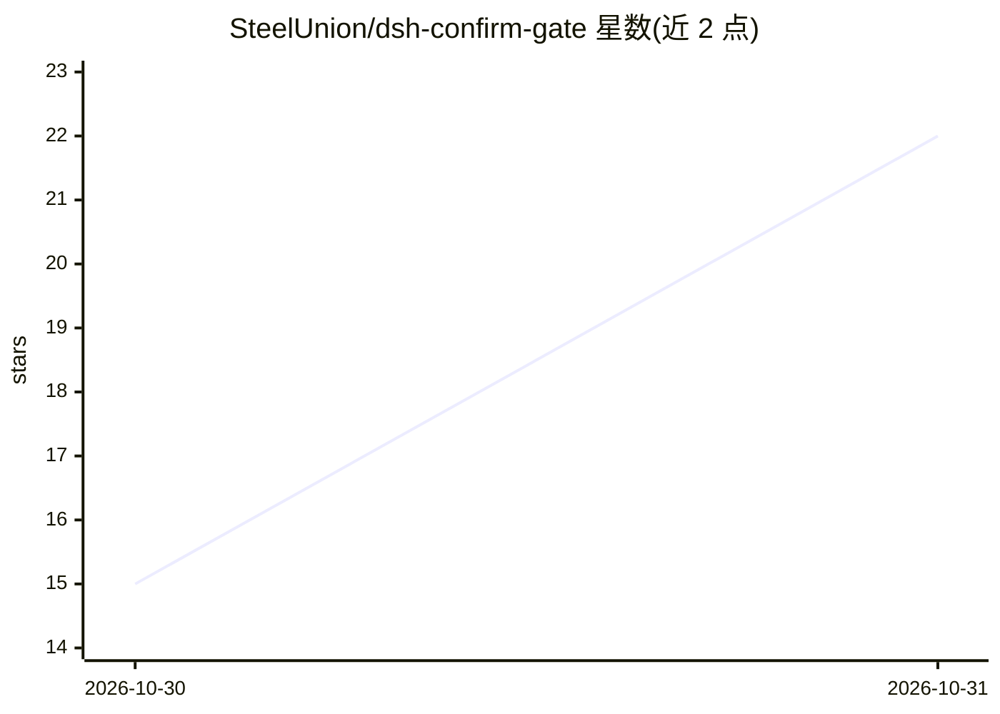

# SteelUnion/dsh-confirm-gate

⭐ 22 · JavaScript · MIT · 推送 2026-10-27 · [GitHub](https://github.com/SteelUnion/dsh-confirm-gate) · [官网](https://github.com/SteelUnion/dsh-confirm-gate#readme) · 个人维护 · 中文 README

**DSH 插件：按回合计数持久操作，超限提醒并要求确认**

DeepSeek Harness（DSH）的运行时插件，对每回合的持久化操作（写文件、执行命令等）计数：freeLimit 内注入提醒，超出后注入停止指令，达到 hardLimit 时返回 ask 并等待用户输入确认词释放整回合。读取/搜索等非持久操作不计数。沙箱/只读模式下自动让位，权限模式可热切换无需重启。零外部依赖，通过 cordis.patch.yml 配置三个参数。威胁模型针对可信用户的失误模型，不防提示注入，命令判定为名称比较而非解析器。

## 筛选速览

| 维度 | 判定 | 备注 |
|---|---|---|
| AI 角色 | `ai-ecosystem` | LLM/agent 周边工具 |
| 许可风险 | `permissive` | MIT |
| 部署形态 | `desktop` | 安装包/桌面程序 |
| 模型依赖 | locked-api |  |
| 硬件要求 | — | 无带数字的原话,不猜 |
| 安装摩擦 | `low` | 无编译、无系统依赖或容器化 |
| 成熟度 | — | 结构信号不足 |

## 能力要点

- 三级递进：提醒→停止指令→hardLimit 阻断并要求确认词
- 沙箱/只读模式下按调用粒度自动让位，支持权限热切换不重启
- 非持久操作（读文件/搜索/列目录）从不计数
- 零外部依赖，三个参数即可调节松紧

## 适用场景

- 授权完整权限后防止模型无界试错烧掉预算
- 离开键盘时让 agent 在写坏大量文件前自行刹车
- 要求 agent 在 N 次写操作后回来找我确认

## 场景标签

 · 领域:AI Agent 治理/插件

## 证据(README 行号)

> L89: A runtime plugin for DeepSeek Harness. It keeps a **per-turn counter of persistent operations**, injects a stop ins
> L53: npx -p @deepseek-ai/dsh dsh plugin --profile web add github:SteelUnion/dsh-confirm-gate

## 星数曲线

2026-10-30 15 → 2026-10-31 22（+7）

---
*卡片 v1 · prompt 1.4 · 生成 2026-10-30 · 置信度 high · 依据 README sha `973a77a6e0b7` · [字段定义](../../DATASET.md)*
