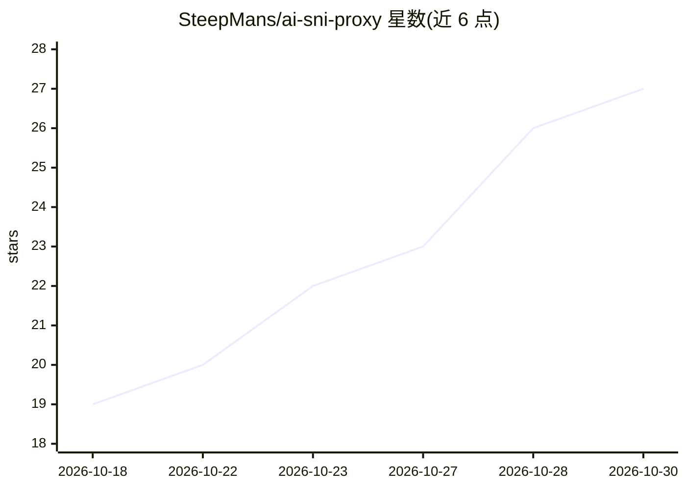

# SteepMans/ai-sni-proxy

⭐ 27 · Shell · MIT · 推送 2026-10-20 · [GitHub](https://github.com/SteepMans/ai-sni-proxy) · 个人维护

**让受限地区无需 VPN 访问 Claude/ChatGPT 等 AI 服务的 SNI 代理工具**

面向身处 AI 服务不服务国家的用户：脚本在系统 hosts 文件中写入一个受控块，将 800+ 个 AI 相关域名指向境外的 SNI 代理服务器，其余流量不受影响。代理仅读取 TLS 握手中的 SNI 字段做路由，不解密流量。客户端以 Windows/macOS/Linux 批处理与 shell 脚本提供 enable/disable/status；域名列表存于服务器端，每次启动时下载。默认出口节点由作者运营，可见用户 IP 与连接元数据；README 提供基于 nginx + Docker 的自建出口节点配置。

## 筛选速览

| 维度 | 判定 | 备注 |
|---|---|---|
| AI 角色 | `ai-ecosystem` | LLM/agent 周边工具 |
| 许可风险 | `permissive` | MIT |
| 部署形态 | `self-host` | docker 或自建部署 |
| 模型依赖 | — | README 未给出锁定关系 |
| 硬件要求 | — | 无带数字的原话,不猜 |
| 安装摩擦 | `low` | 无编译、无系统依赖或容器化 |
| 成熟度 | — | 结构信号不足 |

## 能力要点

- 仅向 hosts 添加受控块，列表外流量不经代理
- 代理只读 TLS SNI 字段，不解密会话内容
- 服务端域名列表 800+ 条，每次启动自动更新
- 提供 nginx + Docker 的自建出口节点配置（约 40 行）

## 适用场景

- 所在地区无法直接访问 Claude/ChatGPT/Gemini/JetBrains AI 时使用这些服务
- 不想用 VPN（VPN 流量特征被过滤识别）的环境下绕过服务端地域拒绝
- 自建境外出口节点，不经过作者服务器转发流量

## 场景标签

 · 领域:网络工具/AI 服务访问

## 证据(README 行号)

> L13: Доступ к Claude, ChatGPT, Gemini, JetBrains AI и ещё 800+ связанным именам из
> L72: Трафик никто не расшифровывает. Прокси читает только имя сервера, которое TLS

## 星数曲线

2026-10-18 19 → 2026-10-30 27（+8）

---
*卡片 v1 · prompt 1.4 · 生成 2026-10-27 · 置信度 mid · 依据 README sha `ab6409712b44` · [字段定义](../../DATASET.md)*
