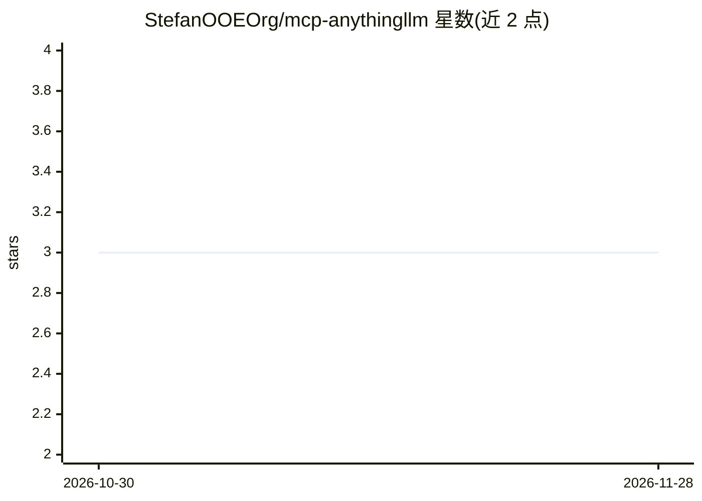

# StefanOOEOrg/mcp-anythingllm

⭐ 3 · Python · MIT · 推送 2026-11-06 · [GitHub](https://github.com/StefanOOEOrg/mcp-anythingllm) · 个人维护

**让 MCP 客户端检索与管理 AnythingLLM 知识库的 stdio 服务器**

以 stdio MCP 服务器形式接入 AnythingLLM 开发者 API，向 MCP 客户端暴露 9 个工具：列出工作区、检索片段、仅基于文档作答（带来源）、列出/读取文档、新增/编辑/替换/删除文档并重新嵌入。写入工具设计为显式请求触发。前置条件为运行中的 AnythingLLM 实例及其 Developer API key；可选只读访问 storage/documents 目录以启用 rag_get。单用户本地运行，无端口、无认证、无多用户支持；API 非 AnythingLLM 公开契约，版本间可能变动。

## 筛选速览

| 维度 | 判定 | 备注 |
|---|---|---|
| AI 角色 | `ai-ecosystem` | LLM/agent 周边工具 |
| 许可风险 | `permissive` | MIT |
| 部署形态 | `library` | 以包/库形式分发 |
| 模型依赖 | — | README 未给出锁定关系 |
| 硬件要求 | — | 无带数字的原话,不猜 |
| 安装摩擦 | `low` | 无编译、无系统依赖或容器化 |
| 成熟度 | — | 结构信号不足 |

## 能力要点

- 9 个 MCP 工具覆盖知识库检索、问答（带来源）与文档增删改
- rag_answer 在无匹配文档时不触发 LLM 调用
- 可配置相似度阈值与 top-N 检索数量
- 附 Markdown 文件夹批量导入脚本，按文件夹映射工作区

## 适用场景

- 让 MCP 客户端查询我上传到 AnythingLLM 的 PDF、Word、网页文档
- 通过对话让 agent 向知识库写入或修订笔记
- 把现有 Markdown 笔记目录批量导入为工作区文档

## 场景标签

`知识库管理` `RAG` `文档问答` · 领域:知识与检索

## 证据(README 行号)

> L6: MCP server (stdio) that gives Hermes access to the knowledge base in
> L11: and embedding model come from an OpenAI-compatible LLM server. This MCP server only talks to
> L12: AnythingLLM's developer API.

## 星数曲线

2026-10-30 3 → 2026-11-28 3（+0）

---
*卡片 v1 · prompt 1.4 · 生成 2026-11-22 · 置信度 high · 依据 README sha `760910273103` · [字段定义](../../DATASET.md)*
