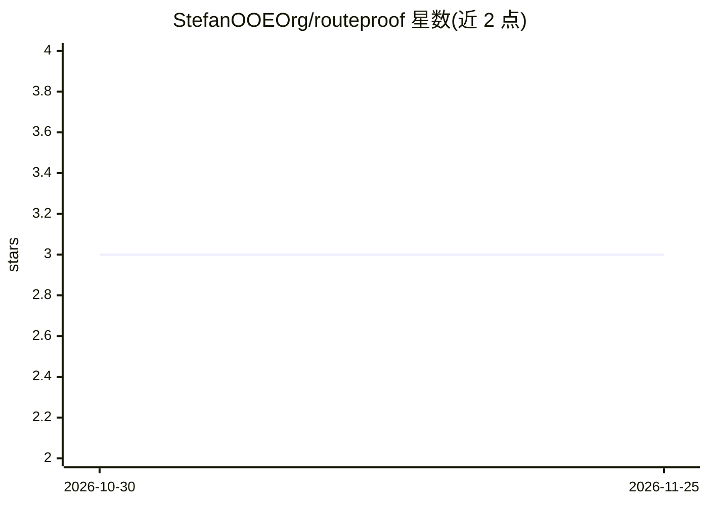

# StefanOOEOrg/routeproof

⭐ 3 · MIT · 推送 2026-11-06 · [GitHub](https://github.com/StefanOOEOrg/routeproof) · 个人维护

**LiteLLM 代理的路由插件：按成本/质量校准模型选择（概念稿）**

Routeproof 是一个概念仓库：目前仅含 Markdown，无可运行代码，自述首个加入代码的 PR 须同时补 CI workflow。设计上它作为插件安装进 LiteLLM 代理：对每个请求做类别/复杂度/置信度分析（规则→bge 嵌入分类器→本地调度 LLM 的级联），按效用函数选最便宜的够用模型，并用五级信号（被动信号、显式反馈、本地 judge、shadow 路由、golden set）测量路由是否正确并校准质量矩阵。网关、密钥、预算、成本计算均留给 LiteLLM，支持提示内指令覆盖与按会话粘滞路由。

## 筛选速览

| 维度 | 判定 | 备注 |
|---|---|---|
| AI 角色 | `ai-ecosystem` | LLM/agent 周边工具 |
| 许可风险 | `permissive` | MIT |
| 部署形态 | `None` |  |
| 模型依赖 | — | README 未给出锁定关系 |
| 硬件要求 | — | 无带数字的原话,不猜 |
| 安装摩擦 | `low` | 无编译、无系统依赖或容器化 |
| 成熟度 | `idea` | |

## 能力要点

- 三级级联提示分析：规则、本地 bge 嵌入分类器、低置信度时的本地调度 LLM
- 五级质量测量信号（被动信号到 shadow 路由）驱动路由校准
- 提示内指令（@model/@premium/@private 等）与 X-Route 头覆盖自动路由
- 按会话粘滞路由，允许升级禁止会话内降级

## 适用场景

- 为已有的 LiteLLM 网关降低模型调用成本并跟踪质量
- 按租户/成本中心统计路由决策与节省
- 用本地小模型调度+云端大模型兜底的分层路由

## 场景标签

`模型网关` `模型评测` · 领域:Agent 开发

## 证据(README 行号)

> L7: Routeproof is an open-source plugin for the LiteLLM proxy (MIT license). It sends every prompt to the cheapest model
> L9: - **A plugin, not a proxy:** Routeproof is installed into a LiteLLM proxy and adds no gateway of its own. Clients ke
> L3: Routeproof is a concept repository: Markdown only, no runnable code, and therefore no CI and no `ci-ok` check. The f

## 星数曲线

2026-10-30 3 → 2026-11-25 3（+0）

---
*卡片 v1 · prompt 1.4 · 生成 2026-11-22 · 置信度 high · 依据 README sha `d3311d4ea6cc` · [字段定义](../../DATASET.md)*
