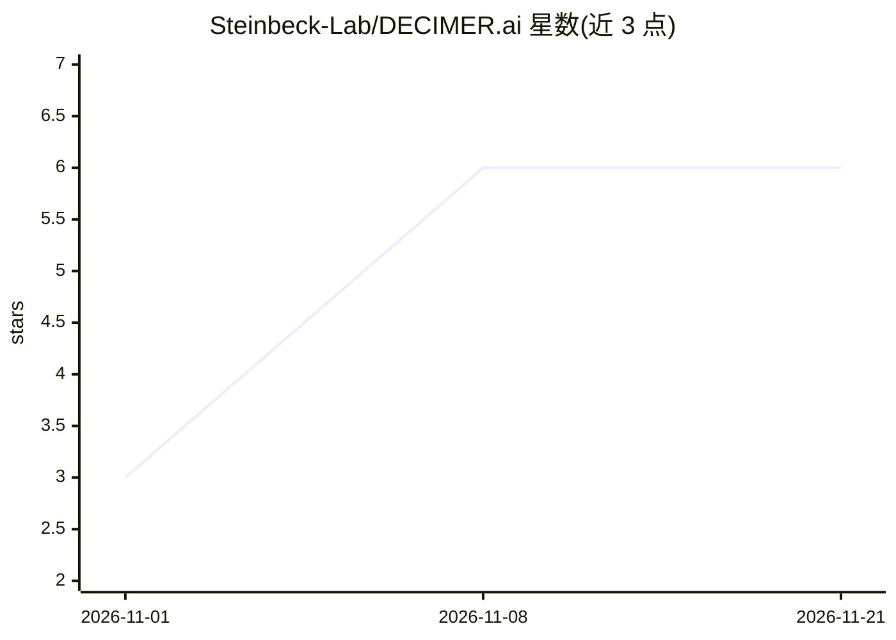

# Steinbeck-Lab/DECIMER.ai

⭐ 6 · Python · MIT · 推送 2026-10-28 · [GitHub](https://github.com/Steinbeck-Lab/DECIMER.ai) · [官网](https://decimer.ai) · 组织维护

**从论文 PDF/图片中提取化学结构并转为 SMILES 的平台**

DECIMER（Deep lEarning for Chemical IMagE Recognition）从科学文献与图像中定位化学结构并输出机器可读 SMILES。流程为上传（PDF/PNG/JPG/WebP/HEIC，单任务限 100MB、10 页、20 个结构）、Mask R-CNN 分割切图、Transformer 识别写 SMILES、RDKit/CDK 校验命名，结果分状态供用户在 Ketcher 旁对照原图修正后导出 ZIP/SDF/CSV。新一代架构为 FastAPI 任务 API + 三个模型服务 + React 应用，经 Docker Compose 自托管部署，模型权重需从 Zenodo 单独下载。

## 筛选速览

| 维度 | 判定 | 备注 |
|---|---|---|
| AI 角色 | `ai-native` | 本体是模型或模型工具 |
| 许可风险 | `permissive` | MIT |
| 部署形态 | `self-host` | docker 或自建部署 |
| 模型依赖 | — | README 未给出锁定关系 |
| 硬件要求 | — | 无带数字的原话,不猜 |
| 安装摩擦 | `low` | 无编译、无系统依赖或容器化 |
| 成熟度 | — | 结构信号不足 |

## 能力要点

- 分割（Mask R-CNN）、识别（Transformer）、分类三个模型服务 + 化学校验服务（RDKit/CDK/Orthonym）
- Ketcher 编辑器旁对照原图逐条修正，按状态（unchecked/review/edited 等）管理结果
- Docker Compose 一键部署，权重经 SHA256 校验从 Zenodo 拉取
- golden-set 检查：模型、TensorFlow、RDKit、CDK 或 PDF 渲染器变更必须通过回归验证

## 适用场景

- 批量从文献 PDF 中提取化学结构图并转成 SMILES 存入数据库
- 对识别结果人工复核修正后导出 SDF/CSV 用于化学信息学流程
- 自托管部署一套内部化学结构识别服务

## 场景标签

`文档解析` `OCR` · 领域:知识与检索

## 证据(README 行号)

> L16: **DECIMER** (Deep lEarning for Chemical IMagE Recognition) finds chemical structures in scientific papers and image
> L19: > This is the next-generation decimer.ai: a FastAPI job API, three model services and a React app. It replaces the 
> L43: One job runs through three model services and a chemistry service, behind a small API. The stages overlap: a page g

## 星数曲线

2026-11-01 3 → 2026-11-21 6（+3）

---
*卡片 v1 · prompt 1.4 · 生成 2026-11-20 · 置信度 high · 依据 README sha `366ce6358cec` · [字段定义](../../DATASET.md)*
