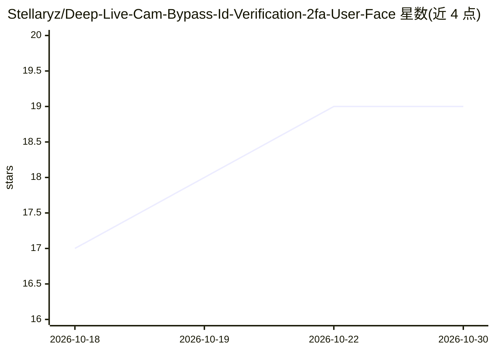

# Stellaryz/Deep-Live-Cam-Bypass-Id-Verification-2fa-User-Face

⭐ 19 · C# · MIT · 推送 2025-12-17 · [GitHub](https://github.com/Stellaryz/Deep-Live-Cam-Bypass-Id-Verification-2fa-User-Face) · 个人维护

**实时模拟人脸的网络摄像头工具，用于测试人脸识别与2FA验证**

基于换脸技术模拟实时摄像头画面，将目标人脸投射到视频流中，模拟眨眼、头部移动与表情等动作；README 声明面向研究、开发与安全审计场景，用于评估人脸认证系统对欺骗攻击的鲁棒性。安装方式为下载 Visual Studio 2022 并打开项目 sln 解决方案编译，随后运行 Debug 目录下的可执行文件；使用流程含生成 SHA-256 哈希密码、可选 API key 与启动服务器连接。仓库同时宣传 Unwind AI 的 LLM 应用清单。

## 筛选速览

| 维度 | 判定 | 备注 |
|---|---|---|
| AI 角色 | `ai-native` | 本体是模型或模型工具 |
| 许可风险 | `permissive` | MIT |
| 部署形态 | `desktop` | 安装包/桌面程序 |
| 模型依赖 | — | README 未给出锁定关系 |
| 硬件要求 | — | 无带数字的原话,不猜 |
| 安装摩擦 | `low` | 无编译、无系统依赖或容器化 |
| 成熟度 | — | 结构信号不足 |

## 能力要点

- 将目标人脸注入实时摄像头视频流
- 模拟眨眼、头部移动、表情等真实动作
- 声明用于人脸识别与 2FA 验证流的安全测试
- 附带 SHA-256 密码生成与服务器连接功能

## 适用场景

- 安全审计中测试人脸认证系统对欺骗攻击的鲁棒性
- 研究与开发中复现验证流程的测试环境

## 场景标签

`人脸识别` `网络安全` · 领域:学习与行业

## 证据(README 行号)

> L7: **Deep Live Cam** is an advanced tool built to simulate real-time webcam feeds using a chosen face, ideal for testin
> L15: * **1. Live Cam Emulation:** Mimics real-time webcam feed.
> L16: * **2. Face Injection:** Projects a target face into live stream.

## 星数曲线

2026-10-18 17 → 2026-10-30 19（+2）

---
*卡片 v1 · prompt 1.4 · 生成 2026-10-29 · 置信度 mid · 依据 README sha `743ee15bdbd2` · [字段定义](../../DATASET.md)*
