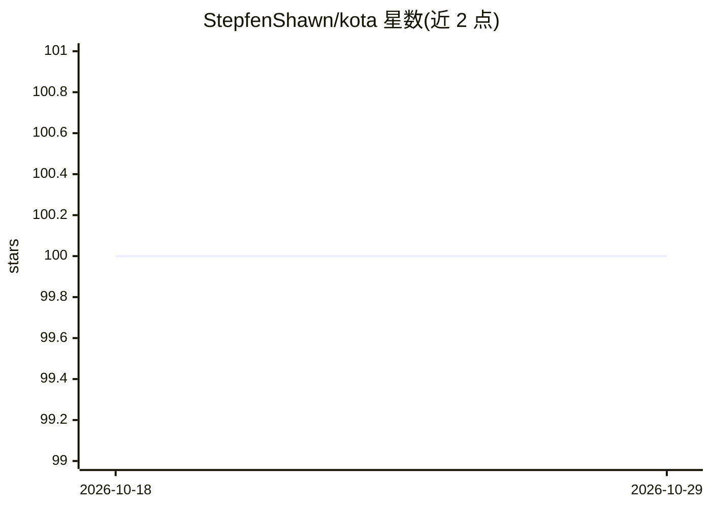

# StepfenShawn/kota

⭐ 100 · Rust · MIT · 推送 2026-04-08 · [GitHub](https://github.com/StepfenShawn/kota) · [官网](https://crates.io/crates/kota) · 个人维护

**Rust 编写的轻量可扩展 AI 编程 Agent（CLI/库）**

用 Rust 实现的 AI 代码代理，可作 CLI 工具或 Rust crate 嵌入项目。采用类 Neovim 的 Lua 配置（.kota/config.lua），内置技能系统（code_review/refactor/debug/documentation）、文件与目录操作、grep 搜索、exec_cmd、计划管理等工具，支持自定义 Lua 命令与 tab 补全。模型接入 OpenAI 兼容 API、DeepSeek、Anthropic Claude，本地模型可经 Ollama 等服务。MCP、插件系统等在 Roadmap 中为规划功能。

## 筛选速览

| 维度 | 判定 | 备注 |
|---|---|---|
| AI 角色 | `ai-native` | 本体是模型或模型工具 |
| 许可风险 | `permissive` | MIT |
| 部署形态 | `library` | 以包/库形式分发 |
| 模型依赖 | local-ok | 支持本地模型 |
| 硬件要求 | — | 无带数字的原话,不猜 |
| 安装摩擦 | `low` | 无编译、无系统依赖或容器化 |
| 成熟度 | — | 结构信号不足 |

## 能力要点

- CLI 与 Rust 库双形态，cargo install 即装
- Lua 配置 + 自定义命令 + 技能系统
- 多 LLM 提供商支持（OpenAI 兼容/DeepSeek/Claude/Ollama 本地模型）
- 内置文件操作、代码扫描、grep、计划管理等工具

## 适用场景

- 在终端里让 AI 做代码审查、重构、调试与写文档
- 作为 Rust crate 构建自定义 AI 代码代理
- 用 Lua 自定义命令与技能适配个人工作流

## 场景标签

`编码 Agent` `代码审查` · 领域:编码与开发

## 证据(README 行号)

> L3: A lightweight, highly extensible ai code agent, built in Rust:
> L18: Whether you use it as a CLI tool or integrate it as a library into your own projects, Kota gives you the power to b
> L112: - **Agent Builder**: Create customized AI code agents with different LLM providers

## 星数曲线

2026-10-18 100 → 2026-10-29 100（+0）

---
*卡片 v1 · prompt 1.4 · 生成 2026-10-23 · 置信度 high · 依据 README sha `9d6551371462` · [字段定义](../../DATASET.md)*
