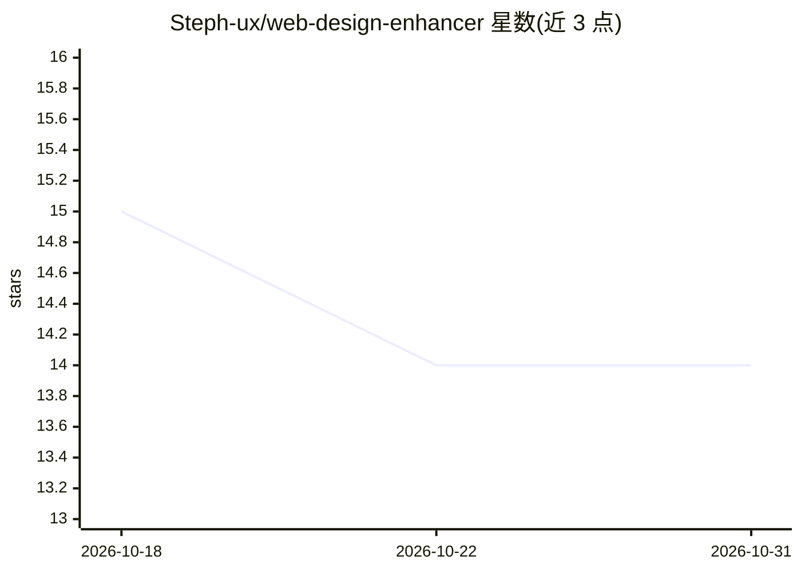

# Steph-ux/web-design-enhancer

⭐ 14 · Python · 推送 2026-09-11 · [GitHub](https://github.com/Steph-ux/web-design-enhancer) · 个人维护

**为 AI 编码 agent 强制执行网页设计质量门禁的编排器**

面向 AI 编码 agent（含 Claude Code、Codex 适配器）的有状态质量编排器：模型提出并实现设计，CLI（wde）负责授权、验证与拦截。用户撰写创意简报后，系统强制选定 10 种设计原型之一、锁定设计契约，再通过 V2 的 10 道机械门禁（反 AI 套路检测、间距、无障碍、美感评分、布局审计等），并用 Playwright MCP 的 Eyes 视觉检查作为交付必经环节，交付需证据信封证明而非聊天声明。以 Python 包安装，附 SKILL.md 薄适配层。

## 筛选速览

| 维度 | 判定 | 备注 |
|---|---|---|
| AI 角色 | `ai-ecosystem` | LLM/agent 周边工具 |
| 许可风险 | `none` | — |
| 部署形态 | `library` | 以包/库形式分发 |
| 模型依赖 | — | README 未给出锁定关系 |
| 硬件要求 | — | 无带数字的原话,不猜 |
| 安装摩擦 | `low` | 无编译、无系统依赖或容器化 |
| 成熟度 | `idea` | |

## 能力要点

- 10 道顺序门禁：反 AI slop 检测、间距/无障碍/美感/布局审计
- 状态机 + 哈希证据信封，模型不可自报通过
- Playwright MCP Eyes 视觉检查为交付定义的一部分
- 10 种设计原型与 open-design 工艺参考集成

## 适用场景

- 防止 AI 生成的网站落入千篇一律的模板化设计
- 在 agent 工作流中用证据链验证 UI 交付质量
- 按原型（奢侈品/编辑/数据看板等）产出差异化设计

## 场景标签

`工作流自动化` · 领域:效率与自动化

## 证据(README 行号)

> L4: Stateful, evidence-driven quality orchestrator for AI coding agents (V3) + battle-tested anti-slop / craft gates (V2
> L53: |Adapters|`adapters/generic`, `claude-code`, `codex`|

## 星数曲线

2026-10-18 15 → 2026-10-31 14（-1）

---
*卡片 v1 · prompt 1.4 · 生成 2026-10-31 · 置信度 high · 依据 README sha `b2c1456c7af4` · [字段定义](../../DATASET.md)*
