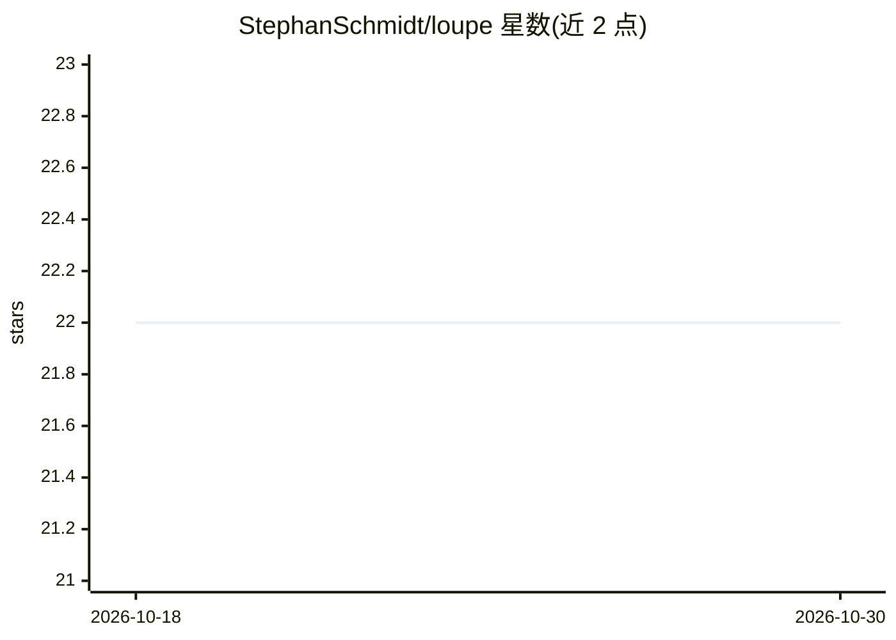

# StephanSchmidt/loupe

⭐ 22 · Go · MIT · 推送 2026-07-17 · [GitHub](https://github.com/StephanSchmidt/loupe) · [官网](https://github.com/StephanSchmidt/loupe) · 个人维护

**本地 CLI：度量代码库中 AI 辅助编写占比并生成汇报幻灯片**

Go 编写的命令行工具，读取提交与 PR 数据，检测 AI 编程助手（Claude Code、Copilot、Cursor、Aider 等 8 种工具）参与编写的代码占比，接入 Bitbucket+Jira、GitHub、GitLab、Azure DevOps 或 Linear。检测分两级置信度：commit trailer、PR 标签、分支前缀等直接证据为高置信；seat-holder 传播为推断。输出 reveal.js 幻灯片与 PNG/SVG 图表，展示吞吐量与采纳率。本地运行，凭据每次运行时交互输入，不提供 ROI 计算。v0.4，部分功能（周度增量更新、静态导出）为 stub。

## 筛选速览

| 维度 | 判定 | 备注 |
|---|---|---|
| AI 角色 | `ai-ecosystem` | LLM/agent 周边工具 |
| 许可风险 | `permissive` | MIT |
| 部署形态 | `desktop` | 安装包/桌面程序 |
| 模型依赖 | — | README 未给出锁定关系 |
| 硬件要求 | — | 无带数字的原话,不猜 |
| 安装摩擦 | `low` | 无编译、无系统依赖或容器化 |
| 成熟度 | `idea` | |

## 能力要点

- 两级置信度的 AI 提交检测（trailer/PR标签/分支前缀/squash 恢复）
- 支持 GitHub/GitLab/Azure DevOps/Bitbucket+Jira/Linear 五种组合
- 生成 reveal.js 幻灯片与 PNG/SVG 图表（吞吐量与采纳率）
- 本地运行，无 SaaS，数据不出本机

## 适用场景

- 向管理层汇报 AI 编程助手的采纳情况
- 季度间对比 AI 辅助编写代码的占比变化
- 统计端到端周期时间（想法→开发→发布）

## 场景标签

 · 领域:开发者效能/AI 采纳度量

## 证据(README 行号)

> L12: A small CLI that looks at your commits and tells you how much of your codebase is being written with AI assistants.
> L23: - AI detection across two confidence tiers: trailers, body footers, AI-bot author identity, PR labels, branch prefi
> L27: - reveal.js deck with weekly throughput (human vs AI evidence vs AI inferred) and adoption %, plus PNG/SVG exports

## 星数曲线

2026-10-18 22 → 2026-10-30 22（+0）

---
*卡片 v1 · prompt 1.4 · 生成 2026-10-27 · 置信度 high · 依据 README sha `e93d762a67d6` · [字段定义](../../DATASET.md)*
