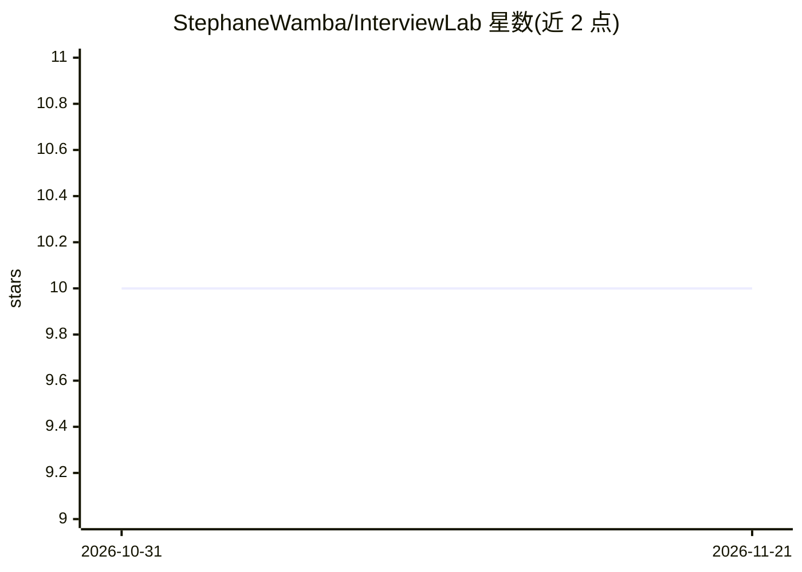

# StephaneWamba/InterviewLab

⭐ 10 · Python · 推送 2026-01-21 · [GitHub](https://github.com/StephaneWamba/InterviewLab) · [官网](https://lab-interview.vercel.app/) · 个人维护

**面向求职者的 AI 语音模拟技术面试练习平台**

模拟真实技术面试的 Web 平台：通过 LiveKit 实时语音对话进行 AI 面试，基于候选人简历生成定制问题，代码题在 Docker 隔离沙箱中执行，结束后输出沟通、技术知识、问题解决与代码质量的分项反馈。后端 FastAPI + LangGraph 状态机编排面试流程，LLM 用 GPT-4o-mini，状态经 PostgreSQL 检查点持久化、Redis 缓存，前端 Next.js。README 定位为作品集项目，展示 AI 系统架构，未给出独立安装包或一键部署命令，仅提供本地开发与 Railway/Vercel 部署文档。

## 筛选速览

| 维度 | 判定 | 备注 |
|---|---|---|
| AI 角色 | `ai-native` | 本体是模型或模型工具 |
| 许可风险 | `none` | — |
| 部署形态 | `None` |  |
| 模型依赖 | — | README 未给出锁定关系 |
| 硬件要求 | — | 无带数字的原话,不猜 |
| 安装摩擦 | `low` | 无编译、无系统依赖或容器化 |
| 成熟度 | `idea` | |

## 能力要点

- 实时语音面试（STT/TTS），延迟低于 3 秒
- 简历定制化问题生成（resume-based questions）
- Docker 隔离沙箱中的实时代码执行
- LangGraph 状态机 + 数据库检查点的面试流程管理

## 适用场景

- 求职前用 AI 面试官做语音模拟技术面试
- 上传简历获取针对个人背景的面试问题
- 获得沟通/技术/代码质量的分项反馈

## 场景标签

`语音 Agent` · 领域:对话与助手

## 证据(README 行号)

> L11: **Solution:** InterviewLab delivers AI-driven technical interviews using real-time voice conversations, live code e
> L41: |**LLM**|GPT-4o-mini|Question generation, decision making|

## 星数曲线

2026-10-31 10 → 2026-11-21 10（+0）

---
*卡片 v1 · prompt 1.4 · 生成 2026-11-20 · 置信度 high · 依据 README sha `5486675bb2da` · [字段定义](../../DATASET.md)*
