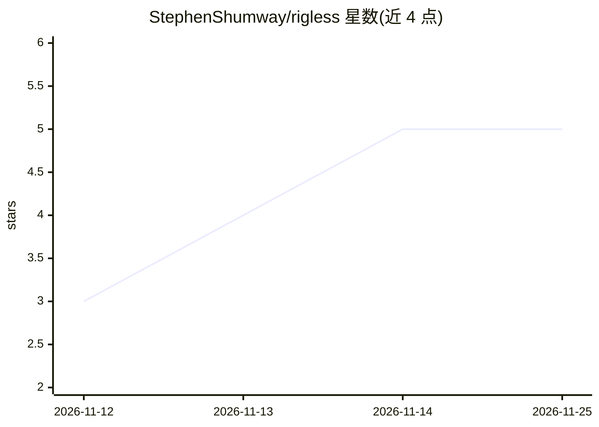

# StephenShumway/rigless

⭐ 5 · Python · Apache-2.0 · 推送 2026-10-31 · [GitHub](https://github.com/StephenShumway/rigless) · 个人维护

**开源换角色应用：点击人物即可替换为自己的角色**

基于 ComfyUI 与 MiniMax H3 的桌面应用，将实拍视频中的表演者替换为用户提供的角色图片。机制：SAM 3.1 跟踪点击的人物，Qwen3-VL 8B 从图片生成角色描述，H3 仅在遮罩内重绘并保留原场景潜变量，附带的 Rigless LoRA 在真实素材上微调，输出后用 RTMPose 逐帧对比姿态打分并标记冻结/镜像片段。渲染需 48GB 以上 NVIDIA GPU 与 CUDA 13，支持 RunPod 租用、本机部署或自定义 GPU 服务器三种方式。Qwen3-VL 8B 为研究许可，默认描述器仅限非商业使用。

## 筛选速览

| 维度 | 判定 | 备注 |
|---|---|---|
| AI 角色 | `ai-native` | 本体是模型或模型工具 |
| 许可风险 | `permissive` | Apache-2.0 |
| 部署形态 | `None` |  |
| 模型依赖 | — | README 未给出锁定关系 |
| 硬件要求 | — | 无带数字的原话,不猜 |
| 安装摩擦 | `medium` | 含编译或系统依赖之一 |
| 成熟度 | — | 结构信号不足 |

## 能力要点

- 点击式人物选择，SAM 3.1 跟踪，最多三人一次替换
- H3 仅在遮罩内重绘，场景、灯光与其他人物保持原片
- Qwen3-VL 8B 自动描述角色并列出表演者有而角色没有的物件
- 每个 take 给 0-100 动作评分并标记冻结/镜像

## 适用场景

- 把实拍视频里的表演者换成自己的原创角色
- 制作多人换装/换角色的短片片段
- 在云端 GPU 或本地服务器上批量生成替换片段

## 场景标签

`视频生成` · 领域:内容生成

## 证据(README 行号)

> L9: Rigless is an open-source app that replaces one or more people in real footage with the
> L13: MiniMax H3 as the core model, and runs
> L14: through the Comfy SDK on a GPU you choose.

## 星数曲线

2026-11-12 3 → 2026-11-25 5（+2）

---
*卡片 v1 · prompt 1.4 · 生成 2026-11-21 · 置信度 high · 依据 README sha `16bbf71a3d59` · [字段定义](../../DATASET.md)*
