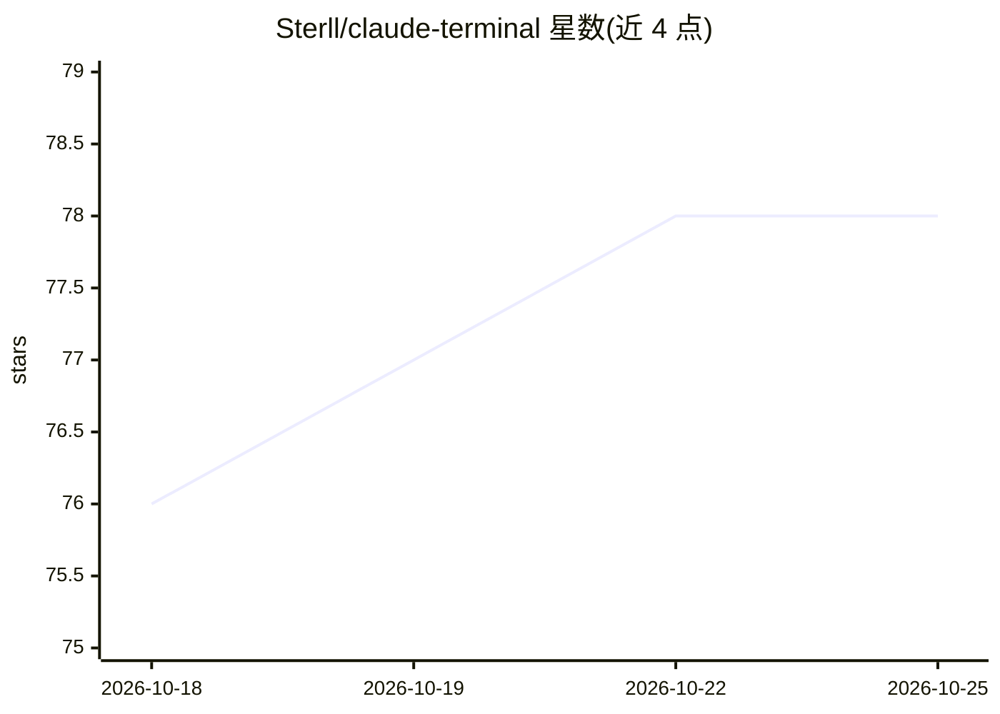

# Sterll/claude-terminal

⭐ 80 · JavaScript · GPL-3.0 · 推送 2026-10-23 · [GitHub](https://github.com/Sterll/claude-terminal) · [官网](https://claudeterminal.dev) · 个人维护

**管理 Claude Code 项目的跨平台桌面应用，集成终端与聊天界面**

基于 Electron 的跨平台桌面应用（Windows/macOS/Linux），面向 Claude Code 使用者：内置聊天界面（基于 Claude Agent SDK，支持流式输出、权限卡片、计划审批、思维块、子代理可视化、文件回退、成本追踪）、多标签终端（xterm.js + WebGL 渲染）、git 工作流（分支管理、同步、冲突解决）、插件与 MCP 工具管理、项目/账户管理、Claude Remote Control 手机接管、语音听写（Groq 转录）等。前提：Node.js 18+ 与全局安装的 Claude Code；从 Releases 下载安装包或源码构建，macOS 未签名需手动绕过。

## 筛选速览

| 维度 | 判定 | 备注 |
|---|---|---|
| AI 角色 | `ai-ecosystem` | LLM/agent 周边工具 |
| 许可风险 | `viral` | GPL-3.0 |
| 部署形态 | `library` | 以包/库形式分发 |
| 模型依赖 | locked-api |  |
| 硬件要求 | — | 无带数字的原话,不猜 |
| 安装摩擦 | `low` | 无编译、无系统依赖或容器化 |
| 成熟度 | — | 结构信号不足 |

## 能力要点

- 基于 Claude Agent SDK 的聊天界面：流式输出、权限卡片、计划模式、文件回退与成本追踪
- 多标签 Claude Code 终端，GPU 加速渲染，捕获输出供工具读取
- 每项目绑定独立 Claude 账户，隔离凭据存储
- 会话可镜像/接管到 claude.ai 与手机端（只读或完整控制）

## 适用场景

- 在图形界面里管理多个 Claude Code 项目并切换账户
- 用聊天或终端两种方式驱动 Claude Code，并审批其计划与工具调用
- 在手机上跟进或接管桌面上的 Claude Code 会话

## 场景标签

`编码 Agent` · 领域:编码与开发

## 证据(README 行号)

> L34:  A cross-platform desktop application for managing
> L35:  Claude Code
> L36:  projects with an integrated terminal environment, git workflows, plugin management,

## 星数曲线

2026-10-18 76 → 2026-10-25 78（+2）

---
*卡片 v1 · prompt 1.4 · 生成 2026-10-24 · 置信度 high · 依据 README sha `95283a3b33c9` · [字段定义](../../DATASET.md)*
