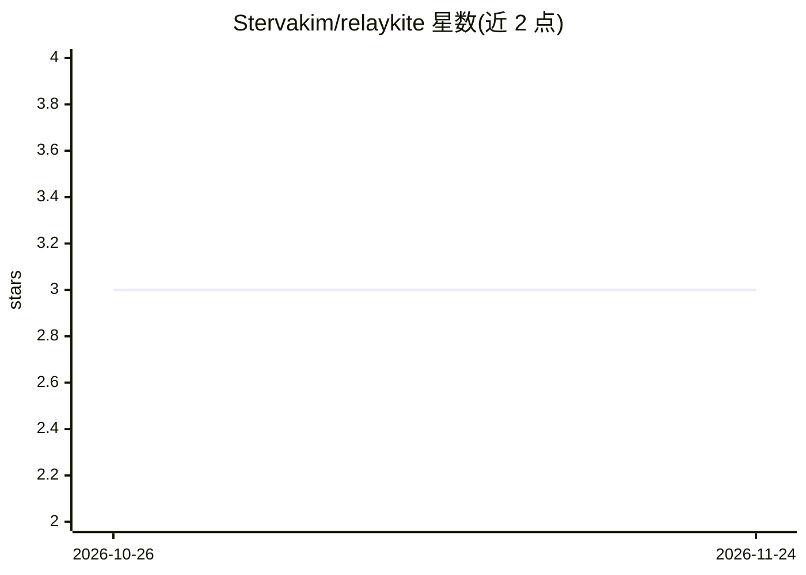

# Stervakim/relaykite

⭐ — · [GitHub]() · 个人维护

**让 ChatGPT 通过私有 MCP 中继控制 Android 与 Windows 设备**

RelayKite 提供本地设备代理，使 ChatGPT 能在用户自有设备上执行点击、滑动、打开应用、文件读写与 PowerShell 任务。Android 代理以 APK 形式内嵌 Python/Node 运行于手机本地，初始配置后日常控制无需常驻电脑、USB 或桌面 ADB；Windows 代理基于 Python 3.14+ 与 PowerShell 独立运行。模型由 ChatGPT 承载，本产品不托管模型权重；任务经用户的私有 HTTPS MCP 中继传递，需自行配置凭据与插件连接。MIT 许可，声明非 OpenAI 官方产品。

## 筛选速览

| 维度 | 判定 | 备注 |
|---|---|---|
| AI 角色 | `ai-ecosystem` | LLM/agent 周边工具 |
| 许可风险 | `permissive` | — |
| 部署形态 | `None` |  |
| 模型依赖 | — | README 未给出锁定关系 |
| 硬件要求 | — | 无带数字的原话,不猜 |
| 安装摩擦 | `low` | 无编译、无系统依赖或容器化 |
| 成熟度 | — | 结构信号不足 |

## 能力要点

- Android 代理内嵌 Bionic Python/Node，配置后无需常驻 PC
- 通过用户私有 HTTPS MCP 中继与个人 ChatGPT 插件连接
- 自主模式包含设备端 Codex 监督器，支持暂停/恢复/取消与检查点记录
- 提供发布 ZIP 与 SHA256SUMS 校验文件，支持由 Codex 协助安装

## 适用场景

- 用对话让 AI 检查手机状态、打开应用、读取屏幕内容
- 在配置的权限范围内让 AI 整理设备文件
- 通过授权的 PowerShell 任务让 AI 查询 Windows 文件夹

## 场景标签

`GUI 自动化` · 领域:效率与自动化

## 证据(README 行号)

> L11: RelayKite gives your AI assistant a way to act on the devices you own. Ask it to inspect your phone, open an app, w
> L13: **The Android agent runs on the phone itself.** After setup, everyday phone control does not require a permanently 
> L53: The model runs in ChatGPT. Ordinary device tools return their result to the conversation; autonomous development ad

## 星数曲线

2026-10-26 3 → 2026-11-24 3（+0）

---
*卡片 v1 · prompt 1.4 · 生成 2026-11-22 · 置信度 high · 依据 README sha `bd06b4a1a6d3` · [字段定义](../../DATASET.md)*
