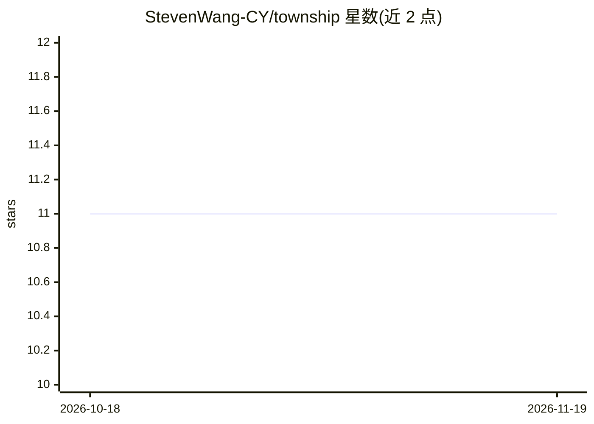

# StevenWang-CY/township

⭐ 11 · Python · MIT · 推送 2026-10-23 · [GitHub](https://github.com/StevenWang-CY/township) · [官网](https://stevenwang-cy.github.io/township/) · 个人维护

**让 AI 居民在像素小镇中推演公民议题的模拟引擎**

开源的公民审议可视化模拟引擎：场景包以 JSON 定义议题、选项、城镇、虚构居民与新闻事件，Python 引擎按 seed→converse→news→opinion→decide 序列运行，事件流驱动 React+Phaser 前端渲染行走、对话与立场变化。每次立场改变都记录原因，运行结果保存为可回放的事件日志。内置无需 API 凭证的确定性 mock 提供者；明确声明输出是模拟产物、不代表真实民意。面向研究、教育、媒介素养与 agent 开发。

## 筛选速览

| 维度 | 判定 | 备注 |
|---|---|---|
| AI 角色 | `ai-native` | 本体是模型或模型工具 |
| 许可风险 | `permissive` | MIT |
| 部署形态 | `library` | 以包/库形式分发 |
| 模型依赖 | local-ok | 支持本地模型 |
| 硬件要求 | — | 无带数字的原话,不猜 |
| 安装摩擦 | `medium` | 含编译或系统依赖之一 |
| 成熟度 | — | 结构信号不足 |

## 能力要点

- 场景包与角色均为 Markdown/JSON 文件，引擎不硬编码议题与居民
- 确定性 mock 提供者支持零凭证离线运行整个流程
- live 与 replay 共用同一事件流，记录的运行可在静态页面回放
- 每位居民带影响账本，opinion_changed 事件引用成因

## 适用场景

- 为选举或预算类议题搭建可回放的模拟推演课堂
- 研究 agent 在新闻事件下的立场变化机制
- 以 God's View 注入假设情境观察居民反应
- 用 mock 提供者离线开发与测试 agent 流水线

## 场景标签

`多智能体` `科研工具` · 领域:Agent 开发

## 证据(README 行号)

> L21: Township is an open-source engine for making civic deliberation visible. A
> L23: context, and news beats. The Python engine runs a configurable sequence of
> L77: - **Bring the model you trust.** Bedrock, Anthropic, OpenAI, OpenRouter, Ollama,

## 星数曲线

2026-10-18 11 → 2026-11-19 11（+0）

---
*卡片 v1 · prompt 1.4 · 生成 2026-11-18 · 置信度 high · 依据 README sha `14fb495e7146` · [字段定义](../../DATASET.md)*
