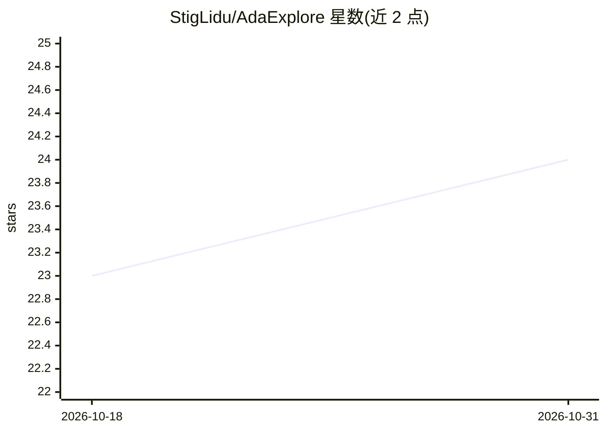

# StigLidu/AdaExplore

⭐ 24 · Python · MIT · 推送 2026-08-23 · [GitHub](https://github.com/StigLidu/AdaExplore) · 组织维护

**LLM 驱动 GPU kernel 生成的论文官方实现**

COLM-LLA 2026 论文 AdaExplore 的研究代码库，面向 LLM 驱动的 GPU kernel 工程。两阶段流程：Adapt 阶段合成训练任务、收集编译/运行失败并蒸馏为跨任务技能记忆；Explore 阶段用保留多样性的树搜索（局部修改与结构重构交替）优化目标 kernel。附评测 harness、合成任务生成管线和可选的多 GPU 远程评测服务。复现实验需 OpenAI API（gpt-5-mini，50 步 Level 2 运行约 10^4 次 API 请求）、Ampere 级 GPU 与 CUDA 12.4，并附预生成技能记忆与已生成 kernel 结果。

## 筛选速览

| 维度 | 判定 | 备注 |
|---|---|---|
| AI 角色 | `ai-native` | 本体是模型或模型工具 |
| 许可风险 | `permissive` | MIT |
| 部署形态 | `None` |  |
| 模型依赖 | — | README 未给出锁定关系 |
| 硬件要求 | — | 无带数字的原话,不猜 |
| 安装摩擦 | `medium` | 含编译或系统依赖之一 |
| 成熟度 | — | 结构信号不足 |

## 能力要点

- Adapt 阶段将重复失败蒸馏为可复用的跨任务技能记忆
- Explore 阶段用树搜索平衡局部修改与结构重构
- 带 per-GPU 限并发与队列的在线评测服务
- 随仓库发布预生成技能记忆与已生成 kernel

## 适用场景

- 复现论文中 KernelBench Level 2/3 的实验结果
- 研究生成 kernel 的正确率与加速比统计
- 在多 GPU 或集群上远程评测候选 kernel

## 场景标签

`代码生成` `Agent 记忆` · 领域:Agent 开发

## 证据(README 行号)

> L10: AdaExplore is a research codebase for **LLM-driven GPU kernel engineering**. The framework is built around two comp
> L96: The exploration stage corresponds to the second half of the paper: AdaExplore uses the skill memory collected durin

## 星数曲线

2026-10-18 23 → 2026-10-31 24（+1）

---
*卡片 v1 · prompt 1.4 · 生成 2026-10-27 · 置信度 high · 依据 README sha `8233d91b28df` · [字段定义](../../DATASET.md)*
