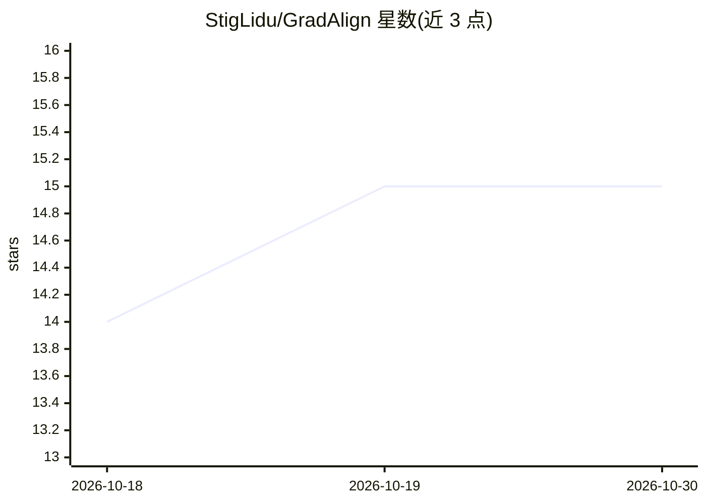

# StigLidu/GradAlign

⭐ 15 · Python · 推送 2026-03-04 · [GitHub](https://github.com/StigLidu/GradAlign) · [官网](https://arxiv.org/abs/2602.21492) · 组织维护

**LLM 强化学习的数据选择方法官方实现（论文代码）**

COLM 2026 论文 GradAlign 的官方实现：在线 RL 数据选择方法，按候选 GRPO 梯度与可信验证集聚合梯度的对齐度对候选训练题目排序，针对奖励不可靠、分布不均衡、低效用大规模网页语料三种场景。基于 VERL 框架运行，提供端到端编排脚本（数据准备、rollout 生成、梯度对齐分析、top-k 选择、GRPO 训练），支持 sim/dot/align/accgreedy/rand 五种选择模式，以及基线运行与检查点合并脚本。多 GPU 运行依赖本地 CUDA、NCCL 与 vLLM 栈。

## 筛选速览

| 维度 | 判定 | 备注 |
|---|---|---|
| AI 角色 | `ai-ecosystem` | LLM/agent 周边工具 |
| 许可风险 | `none` | — |
| 部署形态 | `library` | 以包/库形式分发 |
| 模型依赖 | local-ok | 支持本地模型 |
| 硬件要求 | — | 无带数字的原话,不猜 |
| 安装摩擦 | `medium` | 含编译或系统依赖之一 |
| 成熟度 | — | 结构信号不足 |

## 能力要点

- 按候选梯度与验证集梯度对齐度排序选择训练数据
- 五种选择模式（cosine/dot/无验证集对齐/准确率贪心/随机）
- 基于 VERL 的端到端编排：分块、rollout、对齐分析、top-k、GRPO 训练
- 支持 16 种数据集键与数据混合（mix.py）

## 适用场景

- LLM RL 训练中做在线数据选择以应对不可靠奖励
- 复现论文实验或与随机/无选择基线对比
- 从大规模网页语料中筛选训练子集

## 场景标签

`强化学习` · 领域:训练与推理

## 证据(README 行号)

> L9: GradAlign is an online RL data-selection method that ranks candidate training problems by alignment between:
> L13: The method is designed for non-stationary LLM RL and targets three practical regimes from the paper:

## 星数曲线

2026-10-18 14 → 2026-10-30 15（+1）

---
*卡片 v1 · prompt 1.4 · 生成 2026-10-30 · 置信度 high · 依据 README sha `dd3b7f03ae82` · [字段定义](../../DATASET.md)*
