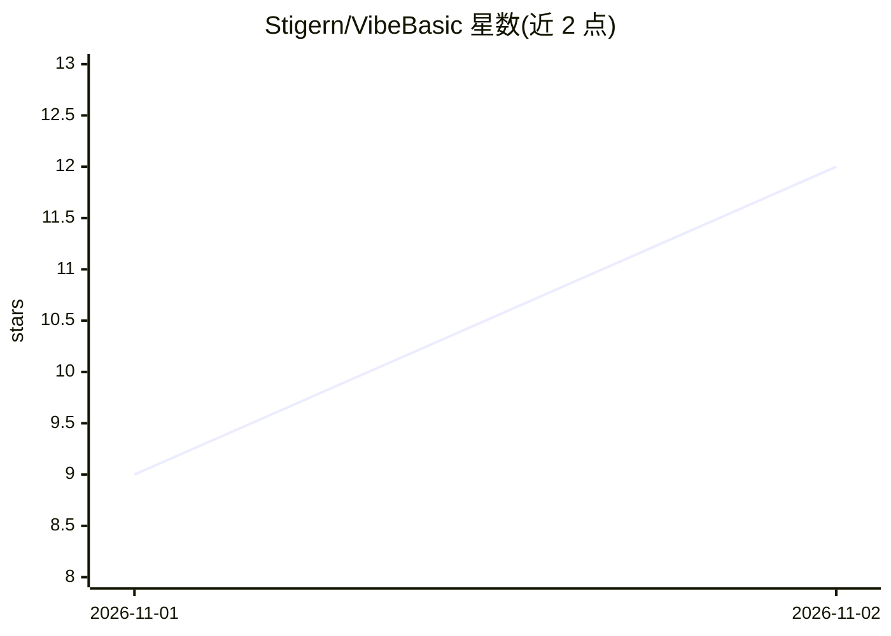

# Stigern/VibeBasic

⭐ 12 · TypeScript · MIT · 推送 2026-10-31 · [GitHub](https://github.com/Stigern/VibeBasic) · [官网](https://stigern.net/) · 个人维护

**面向复古开发者的跨平台 Visual Basic 6 克隆 IDE，内置 AI 助手**

在 macOS、Windows、Linux 上重现 Windows 98 外观的 VB6 开发环境：表单设计器、VB6 语言实现（类模块、文件 I/O、财务函数等）、59 种控件、调试器（断点/单步/监视窗口）、.vbp 工程导入，以及打包为独立应用（.app/.exe/.deb/AppImage）。AI 部分：AI Wizard 从描述生成新程序、Ask AI 在代码窗口写代码或布局控件、错误对话框建议修复、LAN/Tailscale 本地 AI 服务器发现。AI 通过 OpenAI 兼容接口连接 Ollama 或 vLLM。基于 Tauri 2 构建，发布包未经签名需手动放行。

## 筛选速览

| 维度 | 判定 | 备注 |
|---|---|---|
| AI 角色 | `ai-enhanced` | 去掉 AI 部分产品仍成立 |
| 许可风险 | `permissive` | MIT |
| 部署形态 | `desktop` | 安装包/桌面程序 |
| 模型依赖 | local-ok | 支持本地模型 |
| 硬件要求 | — | 无带数字的原话,不猜 |
| 安装摩擦 | `low` | 无编译、无系统依赖或容器化 |
| 成熟度 | — | 结构信号不足 |

## 能力要点

- AI Wizard 从文字描述生成完整 VB6 程序
- Ask AI 写代码/布局控件，建议以预览形式应用为单步撤销
- LAN/Tailscale 网络内自动发现本地 AI 服务器
- 支持导入 .vbp 工程并报告不兼容项
- 59 种控件含 TreeView、Winsock、MSComm、SQLite 数据绑定等

## 适用场景

- 在 macOS/Linux 上继续编写和运行老 VB6 工程
- 用自然语言描述快速生成小工具程序
- 连接本机或局域网内的 Ollama 模型辅助写 VB 代码

## 场景标签

`代码生成` · 领域:编码与开发

## 证据(README 行号)

> L5: A Visual Basic 6 clone for macOS, Windows and Linux, with the authentic Windows 98 look and a built-in AI assistant 
> L32: - **AI assistant:** connects to any OpenAI-compatible server, such as Ollama or vLLM.
> L33:  - **AI Wizard** under Tools or File > New Project builds a new program from your description. Pick an example, col

## 星数曲线

2026-11-01 9 → 2026-11-02 12（+3）

---
*卡片 v1 · prompt 1.4 · 生成 2026-11-02 · 置信度 high · 依据 README sha `0d9876a0ac73` · [字段定义](../../DATASET.md)*
