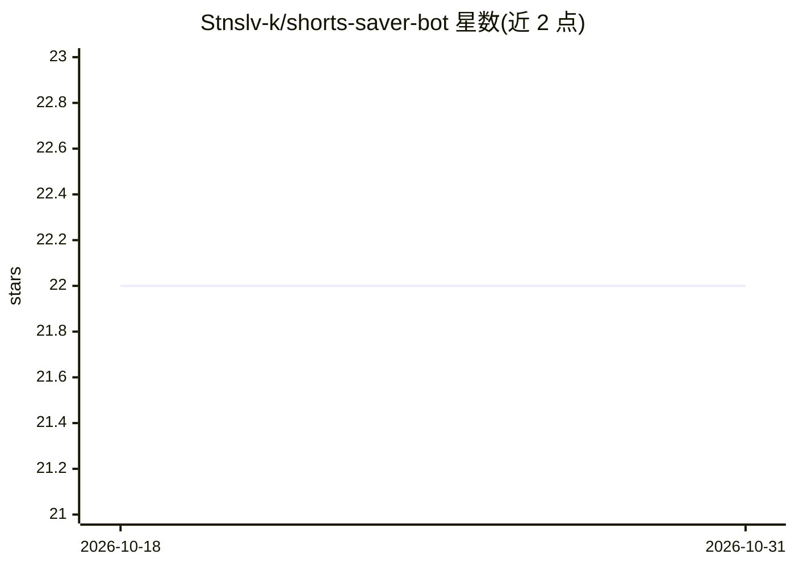

# Stnslv-k/shorts-saver-bot

⭐ 22 · Python · MIT · 推送 2026-05-14 · [GitHub](https://github.com/Stnslv-k/shorts-saver-bot) · 个人维护

**自托管 Telegram bot：AI 提取 YouTube Shorts 内容存入 Notion/Obsidian**

面向个人知识管理用户的自托管 Telegram bot：接收 YouTube Shorts 链接后抓取字幕或下载音频并用 faster-whisper 本地转录，可选 Vision 分析关键帧，再由 LLM 提取结构化条目（标题、摘要、分类、GitHub 仓库、标签等）保存到 Notion 或 Obsidian。支持 Ollama/OpenAI/Anthropic/OpenRouter 四种 LLM 后端并可配置回退，OpenRouter 模式可自动轮询免费模型。需 Python 3.11+、ffmpeg 与 Telegram bot token，提供 Docker 部署；作者在 Gumroad 另售一键安装包。

## 筛选速览

| 维度 | 判定 | 备注 |
|---|---|---|
| AI 角色 | `ai-native` | 本体是模型或模型工具 |
| 许可风险 | `permissive` | MIT |
| 部署形态 | `self-host` | docker 或自建部署 |
| 模型依赖 | local-ok | 支持本地模型 |
| 硬件要求 | — | 无带数字的原话,不猜 |
| 安装摩擦 | `low` | 无编译、无系统依赖或容器化 |
| 成熟度 | — | 结构信号不足 |

## 能力要点

- 字幕优先、faster-whisper 本地转录兜底的转写管线
- 4 种 LLM 后端（Ollama/OpenAI/Anthropic/OpenRouter）+ 可选回退链
- OpenRouter 智能模式按免费模型排名轮询并降级到付费回退
- Notion 与 Obsidian 双存储后端，支持 /setup Telegram 内配置

## 适用场景

- 刷到 Shorts 时一键把要点存进 Obsidian/Notion 笔记库
- 本地 Ollama 后端实现零成本、数据不出门的短视频知识提取
- 通过 /history 在 Telegram 内管理已保存条目

## 场景标签

`知识库管理` `语音识别` · 领域:知识与检索

## 证据(README 行号)

> L3: A Telegram bot that processes YouTube Shorts links, extracts structured knowledge with an LLM, and saves it to Notio
> L10: 4. An LLM extracts a structured knowledge entry.

## 星数曲线

2026-10-18 22 → 2026-10-31 22（+0）

---
*卡片 v1 · prompt 1.4 · 生成 2026-10-27 · 置信度 high · 依据 README sha `bc43f42f5122` · [字段定义](../../DATASET.md)*
