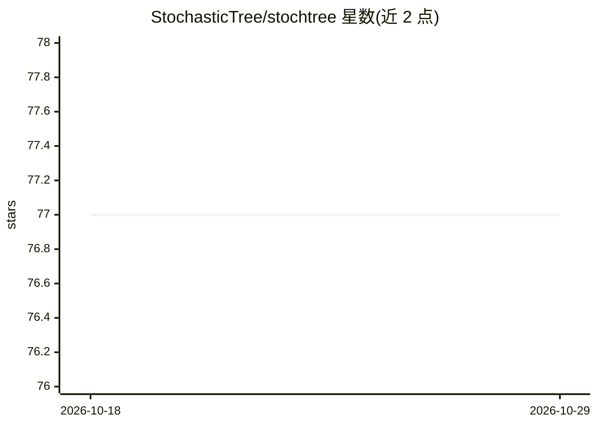

# StochasticTree/stochtree

⭐ 77 · C++ · NOASSERTION · 推送 2026-10-05 · [GitHub](https://github.com/StochasticTree/stochtree) · [官网](https://stochtree.ai/) · 组织维护

**构建随机树集成（BART/XBART）用于监督学习与因果推断**

由 C++ 核心、Python 与 R 接口三层构成的随机树集成软件：提供 BART/XBART 类树集成模型的训练，用于监督学习与因果推断。Python 包可经 PyPI 或源码 pip 安装（要求 Python 3.8+），R 包可从 CRAN 安装；C++ 核心可通过 CMake 独立编译并运行调试程序与 GoogleTest 单元测试，依赖以 git submodule 形式引入。README 提供了 conda/venv 环境管理与 Xcode 调试配置说明。

## 筛选速览

| 维度 | 判定 | 备注 |
|---|---|---|
| AI 角色 | `ai-native` | 本体是模型或模型工具 |
| 许可风险 | `none` | NOASSERTION |
| 部署形态 | `library` | 以包/库形式分发 |
| 模型依赖 | — | README 未给出锁定关系 |
| 硬件要求 | — | 无带数字的原话,不猜 |
| 安装摩擦 | `medium` | 含编译或系统依赖之一 |
| 成熟度 | — | 结构信号不足 |

## 能力要点

- BART/XBART 随机树集成，支持监督学习与因果推断
- C++ 核心 + Python/R 双语言接口
- CMake 独立编译 C++ 核心，含调试程序与 GoogleTest 单元测试

## 适用场景

- 用 BART/XBART 做回归或分类建模
- 因果推断场景下估计处理效应
- 在 R 或 Python 工作流中调用同一 C++ 核心实现

## 场景标签

 · 领域:机器学习/统计建模

## 证据(README 行号)

> L7: Software for building stochastic tree ensembles (i.e. BART, XBART) for supervised learning and causal inference.
> L11: `stochtree` is composed of a C++ "core" and R / Python interfaces to that core.

## 星数曲线

2026-10-18 77 → 2026-10-29 77（+0）

---
*卡片 v1 · prompt 1.4 · 生成 2026-10-24 · 置信度 high · 依据 README sha `63ec1c18d982` · [字段定义](../../DATASET.md)*
