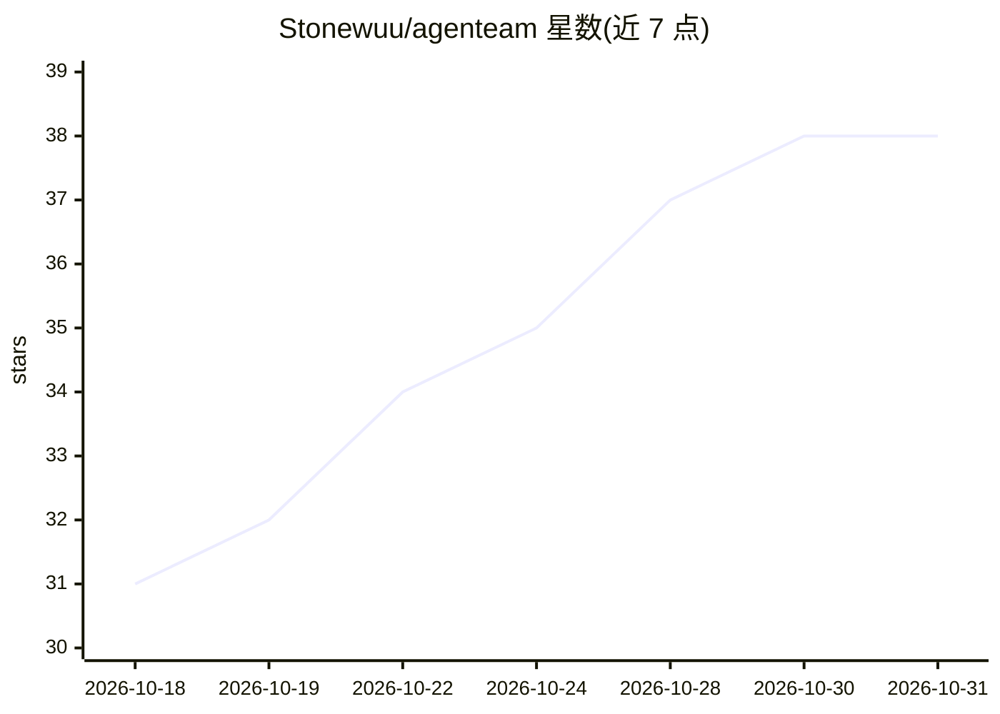

# Stonewuu/agenteam

⭐ 38 · Java · Apache-2.0 · 推送 2026-10-27 · [GitHub](https://github.com/Stonewuu/agenteam) · 个人维护 · 中文 README

**开源企业级多智能体协作平台，组建数字员工团队**

自部署的多智能体协作平台：把模型、知识、技能和工具组合成“数字员工”，在工作台中完成多轮对话任务、文件处理、待办跟进与定时任务，并通过企业微信和飞书接入团队协作。能力中心维护智能体、知识库与数据源，支持兼容 OpenAI 接口的模型服务和 MCP 工具。技术栈为 Java 21 + Spring Boot 4 + AgentScope 2 后端、Next.js 前端，MySQL/Redis 存储；通过 Docker Compose 或源码部署。目标用户为需要 AI 数字员工的企业团队。

## 筛选速览

| 维度 | 判定 | 备注 |
|---|---|---|
| AI 角色 | `ai-native` | 本体是模型或模型工具 |
| 许可风险 | `permissive` | Apache-2.0 |
| 部署形态 | `self-host` | docker 或自建部署 |
| 模型依赖 | — | README 未给出锁定关系 |
| 硬件要求 | — | 无带数字的原话,不猜 |
| 安装摩擦 | `low` | 无编译、无系统依赖或容器化 |
| 成熟度 | — | 结构信号不足 |

## 能力要点

- 数字员工：组合模型、技能、知识库与工具，发布上架供成员雇佣
- 对话中支持多轮交流、工具调用、子智能体协作与人工确认
- 企业微信与飞书集成：账号登录、业务通知、定时通知
- 待办与一次性/每日/每周/每月定时任务，支持 OpenAI 兼容模型与 MCP 工具

## 适用场景

- 为不同岗位配置数字员工处理日常对话任务和办公文件
- 团队通过企业微信/飞书接收任务完成与待办通知
- 按周期计划自动执行智能体任务或发送通知

## 场景标签

`多智能体` `AI 助手` `工作流自动化` · 领域:Agent 开发

## 证据(README 行号)

> L14: **AgenTeam（群策）是一个开源、可自主部署的多智能体协作平台，让数字员工参与团队的日常工作。**
> L16: 把模型、知识、技能和工具组合成数字员工，在同一工作台中完成对话任务、处理文件、协作跟进待办，并通过企业微信和飞书连接团队。你可以按项目组织工作，持续复用任务上下文与生成的成果。
> L22: |为不同岗位配置数字员工|组合模型、技能、知识库和工具，发布智能体并供成员雇佣使用。|

## 星数曲线

2026-10-18 31 → 2026-10-31 38（+7）

---
*卡片 v1 · prompt 1.4 · 生成 2026-10-25 · 置信度 mid · 依据 README sha `d5be809f7a70` · [字段定义](../../DATASET.md)*
