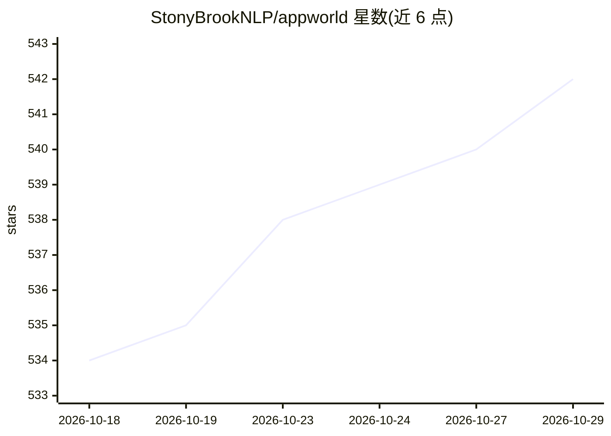

# StonyBrookNLP/appworld

⭐ 542 · Python · Apache-2.0 · 推送 2026-09-04 · [GitHub](https://github.com/StonyBrookNLP/appworld) · [官网](https://appworld.dev/) · 组织维护

**评测函数调用与交互式编码 agent 的模拟应用世界基准**

包含 AppWorld Engine 与 AppWorld Benchmark 两部分：Engine 是 9 个日常应用（Amazon、Spotify 等）的高保真执行环境，提供 457 个 API 与 100+ 数据库表，并以约 100 个模拟人物的数字活动填充数据；Benchmark 在其上构建需交互式编码与 API 调用的自主 agent 任务。用户通过 Python 库或 CLI 编写、运行与评测自己的 agent，内置 tool-use、MCP、coding agent 等 5+ 实现，支持 100+ 模型。大部分代码以加密 .bundle 文件发布以防止进入训练语料，test 集不公开 setup 与解答。需 Python 3.11+，ACL'24 最佳资源论文。

## 筛选速览

| 维度 | 判定 | 备注 |
|---|---|---|
| AI 角色 | `ai-ecosystem` | LLM/agent 周边工具 |
| 许可风险 | `permissive` | Apache-2.0 |
| 部署形态 | `library` | 以包/库形式分发 |
| 模型依赖 | — | README 未给出锁定关系 |
| 硬件要求 | — | 无带数字的原话,不猜 |
| 安装摩擦 | `low` | 无编译、无系统依赖或容器化 |
| 成熟度 | — | 结构信号不足 |

## 能力要点

- 9 个日常应用、457 个 API、约 100 个模拟人物的可控沙盒环境
- 自然多样的交互式编码与函数调用 agent 基准任务
- 提供 MCP Server/Client 及 5+ 内置 agent 实现，支持 100+ 模型
- test 集仅发布评测程序，防止数据泄露（.bundle 加密与金丝雀字符串）

## 适用场景

- 评测我的 agent 在交互式编码与函数调用任务上的表现
- 在可控的应用沙盒环境中迭代开发 agent
- 通过 MCP 接入 Codex、Gemini 等终端 agent 进行评测

## 场景标签

`模型评测` · 领域:评测与运维

## 证据(README 行号)

> L86: This work introduces AppWorld Engine, a high-fidelity execution environment of 9 day-to-day apps, operable via 457 
> L108: # Install appworld-agents and run any of 5+ agents with 100+ models.
> L110: appworld run auto --agent-name {AGENT_NAME} --model-name {MODEL_NAME} --dataset-name test_challenge

## 星数曲线

2026-10-18 534 → 2026-10-29 542（+8）

---
*卡片 v1 · prompt 1.4 · 生成 2026-10-23 · 置信度 high · 依据 README sha `4ebd23ac7313` · [字段定义](../../DATASET.md)*
