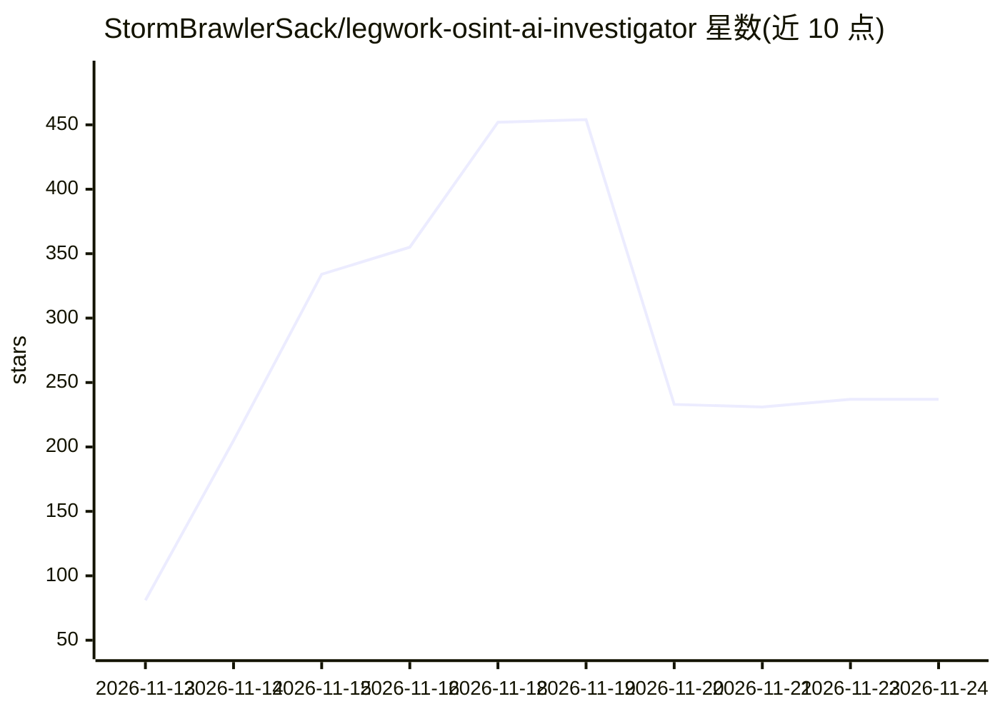

# StormBrawlerSack/legwork-osint-ai-investigator

⭐ 237 · JavaScript · MIT · 推送 2026-11-13 · [GitHub](https://github.com/StormBrawlerSack/legwork-osint-ai-investigator) · [官网](https://awesomeosint.tools/legwork/) · 个人维护

**Windows 版 AI 开源情报调查员：逐句带出处的问答**

面向 Windows 的 OSINT 调查应用：用户用自然语言提问，应用检索并阅读公开网页，逐句写出带引用来源的回答；被来源支撑的关键短语以高亮标注，来源以卡片列于回答下方，并显示阅读的公开页面数。机制上遵循“无来源不成句”规则：单一来源的说法被剔除，空白处如实说明而非猜测。当前版本 v1.2.1，以 Windows 下载方式提供。

## 筛选速览

| 维度 | 判定 | 备注 |
|---|---|---|
| AI 角色 | `ai-native` | 本体是模型或模型工具 |
| 许可风险 | `permissive` | MIT |
| 部署形态 | `None` |  |
| 模型依赖 | — | README 未给出锁定关系 |
| 硬件要求 | — | 无带数字的原话,不猜 |
| 安装摩擦 | `low` | 无编译、无系统依赖或容器化 |
| 成熟度 | — | 结构信号不足 |

## 能力要点

- 逐句引用：每句回答标注其来源的公开网页
- 关键短语高亮显示，来源以卡片形式排列
- 单一来源的说法被剔除，空白如实说明
- 显示撰写回答所阅读的公开页面数量

## 适用场景

- 调查'某人/某实体背后是谁'类问题时逐句核验出处
- 把分散在多个标签页的开源情报调查整理为一份带引用的回答
- 希望不盲信 AI 回答、逐句检查来源的调研工作

## 场景标签

`科研工具` · 领域:学习与行业

## 证据(README 行号)

> L4:  You ask. It does the legwork. An AI investigator that answers with a source on every sentence.
> L15: Search engines answer queries; Legwork answers questions. It reads the sources it finds and writes the answer with 

## 星数曲线

2026-11-13 81 → 2026-11-24 237（+156）

---
*卡片 v1 · prompt 1.4 · 生成 2026-11-17 · 置信度 mid · 依据 README sha `36478c6fcc14` · [字段定义](../../DATASET.md)*
