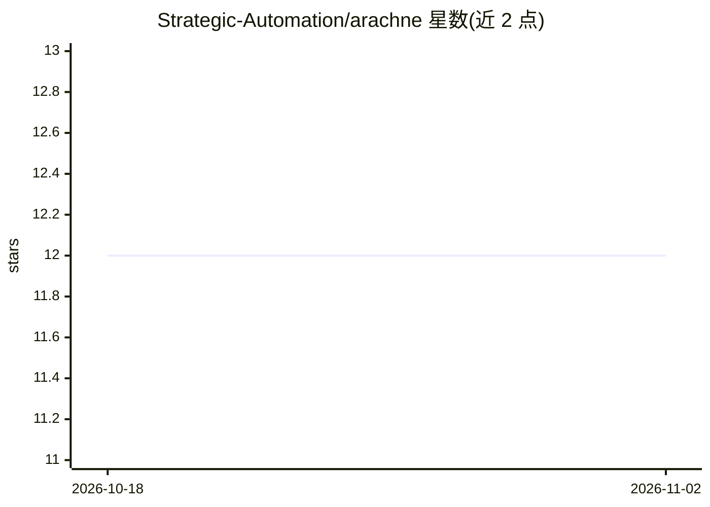

# Strategic-Automation/arachne

⭐ 12 · Python · MIT · 推送 2026-09-18 · [GitHub](https://github.com/Strategic-Automation/arachne) · 组织维护

**DSPy 原生的自愈式 agent 图运行时：目标转图并执行**

面向用自然语言描述目标的开发者：Arachne 将目标编织为 Pydantic/DSPy 结构化的 GraphTopology 有向图，配置工具后按拓扑波次并行执行节点，结合规则与语义评分评估输出，失败时可重试、改路由或重织图。运行时提供持久会话、检查点与缓存以支持审计和恢复，内置工具与 MCP 集成共用同一解析路径，可开启交互式人工审核。以 Python 3.11+ CLI 形式提供，通过克隆仓库与 quickstart 脚本安装；当前处 0.1.x Beta，接口可能变动。

## 筛选速览

| 维度 | 判定 | 备注 |
|---|---|---|
| AI 角色 | `ai-ecosystem` | LLM/agent 周边工具 |
| 许可风险 | `permissive` | MIT |
| 部署形态 | `None` |  |
| 模型依赖 | — | README 未给出锁定关系 |
| 硬件要求 | — | 无带数字的原话,不猜 |
| 安装摩擦 | `low` | 无编译、无系统依赖或容器化 |
| 成熟度 | `idea` | |

## 能力要点

- 自然语言目标生成 Pydantic GraphTopology 结构化图而非提示链
- 拓扑波次并行执行与异步并发
- 自愈循环：失败/低质量运行可重试、改路由或重织
- 持久会话、缓存与检查点支持审计、恢复与复用

## 适用场景

- 用一句目标描述让运行时自动编织并执行多步 agent 任务
- 对失败的 agent 运行进行自愈重试或重新规划
- 在交互模式下人工审核并调整生成的执行计划

## 场景标签

`Agent 框架` · 领域:Agent 开发

## 证据(README 行号)

> L9: **Stop prompting. Start programming.** Arachne turns natural-language goals into typed, inspectable, DSPy-native exe
> L28: - **DSPy-native graph weaving** — goals become structured `GraphTopology` models rather than hidden prompt chains.

## 星数曲线

2026-10-18 12 → 2026-11-02 12（+0）

---
*卡片 v1 · prompt 1.4 · 生成 2026-11-01 · 置信度 high · 依据 README sha `d3201b7f33d7` · [字段定义](../../DATASET.md)*
