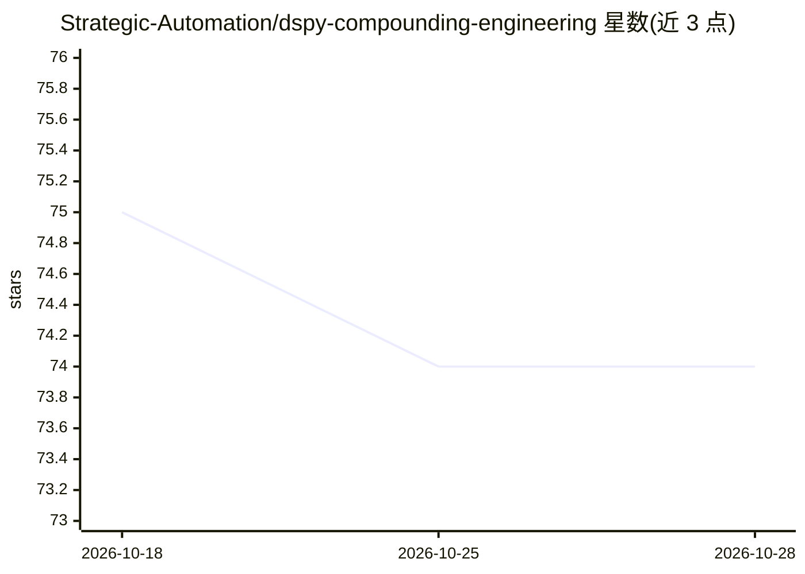

# Strategic-Automation/dspy-compounding-engineering

⭐ 74 · Python · 推送 2026-06-13 · [GitHub](https://github.com/Strategic-Automation/dspy-compounding-engineering) · [官网](https://strategic-automation.github.io/dspy-compounding-engineering/) · 组织维护

**本地优先的 AI 工程代理 CLI：代码审查、规划与工作流自动化并持续积累经验**

基于 DSPy 构建的命令行工程工具：运行 10+ 专项审查代理并行做代码审查，含 ReAct 文件编辑执行待办、从描述或 GitHub issue 生成实现计划、交互式分诊与自然语言生成新代理。核心机制是复合工程知识库：每次任务自动提炼经验存入 .knowledge/ 的 JSON，并通过 KBPredict 注入后续 AI 操作；Qdrant 提供语义检索，未启动时回退关键词搜索。本地优先运行，支持 MCP 客户端（如 Claude Desktop）挂载，LLM 供应商经 .env 配置。

## 筛选速览

| 维度 | 判定 | 备注 |
|---|---|---|
| AI 角色 | `ai-native` | 本体是模型或模型工具 |
| 许可风险 | `none` | — |
| 部署形态 | `self-host` | docker 或自建部署 |
| 模型依赖 | local-ok | 支持本地模型 |
| 硬件要求 | — | 无带数字的原话,不猜 |
| 安装摩擦 | `low` | 无编译、无系统依赖或容器化 |
| 成熟度 | — | 结构信号不足 |

## 能力要点

- 10+ 专项审查代理并行代码审查（安全/性能/架构等）
- 知识库自动提炼与注入：每次任务产出可复用经验
- ReAct 文件编辑、隔离 worktree 与并行 todo 执行
- FastMCP 服务器可挂载到 Claude Desktop 等 MCP 客户端

## 适用场景

- 对本地改动或 PR 跑多代理代码审查并分诊发现
- 把功能描述或 GitHub issue 转成实现计划并自动执行
- 让审查经验在项目知识库中沉淀、复用

## 场景标签

`代码审查` `工作流自动化` · 领域:效率与自动化

## 证据(README 行号)

> L17: This CLI tool provides AI-powered development tools for code review, planning, and workflow automation, following t
> L28: - **🔍 Multi-Agent Code Review**: Run 10+ specialized review agents in parallel
> L335: ### 3. Intelligence Layer (DSPy Agents)

## 星数曲线

2026-10-18 75 → 2026-10-28 74（-1）

---
*卡片 v1 · prompt 1.4 · 生成 2026-10-24 · 置信度 mid · 依据 README sha `5008733497a3` · [字段定义](../../DATASET.md)*
