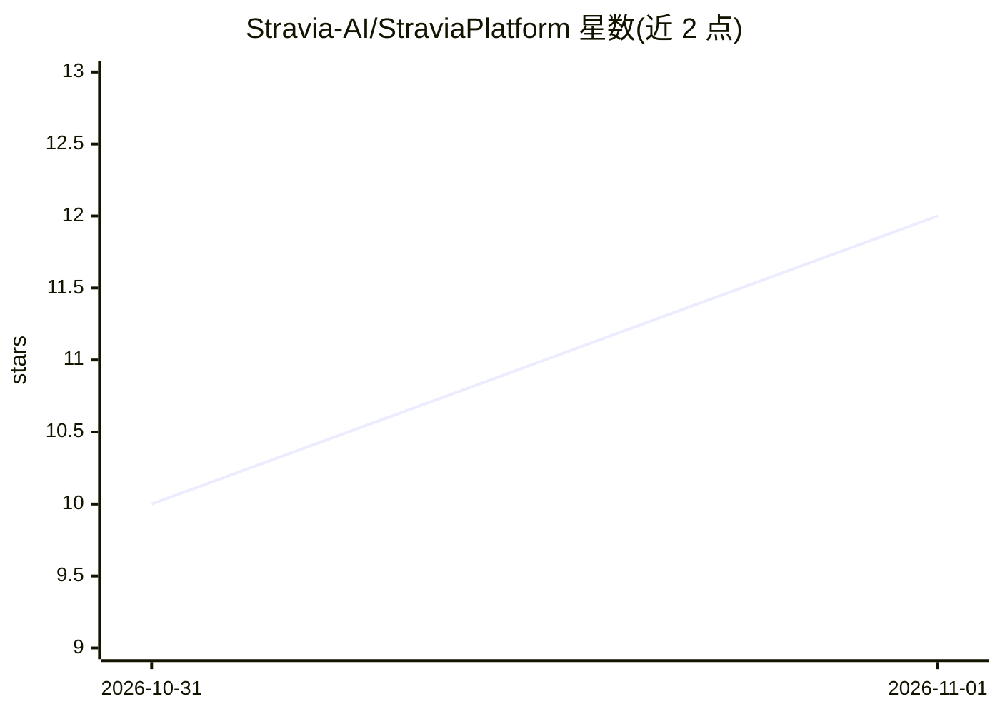

# Stravia-AI/StraviaPlatform

⭐ 12 · Rust · AGPL-3.0 · 推送 2026-10-30 · [GitHub](https://github.com/Stravia-AI/StraviaPlatform) · [官网](https://www.stravia.cn/) · 组织维护 · 中文 README

**本地自托管 agent 基础设施：为各类 AI 客户端提供统一接入端点**

面向使用 AI 编程客户端或构建 agent 应用的开发者：Claude Code、Codex CLI、Gemini CLI、OpenCode 等客户端指向单一端点（默认 127.0.0.1:23471），由其完成 OpenAI/Anthropic/Gemini 协议互译、上游模型路由、重试与故障切换。平台自运行工具（文件/网页读取、网页搜索、图像理解与生成），可经 MCP 或自动注入暴露；提供请求历史、用量统计、API key 管理与本地凭证脱敏。形态为桌面应用或单一 Rust 二进制，SQLite 默认、可选 PostgreSQL。pre-1.0 阶段，配置与数据库兼容性可能变动；macOS 桌面构建暂不提供。

## 筛选速览

| 维度 | 判定 | 备注 |
|---|---|---|
| AI 角色 | `ai-ecosystem` | LLM/agent 周边工具 |
| 许可风险 | `viral` | AGPL-3.0 |
| 部署形态 | `self-host` | docker 或自建部署 |
| 模型依赖 | local-ok | 支持本地模型 |
| 硬件要求 | — | 无带数字的原话,不猜 |
| 安装摩擦 | `low` | 无编译、无系统依赖或容器化 |
| 成熟度 | `idea` | |

## 能力要点

- OpenAI/Anthropic/Gemini 多协议统一端点与跨协议互译
- 优先级分层的模型路由、重试与故障切换
- 平台内置工具（网页搜索、媒体理解/生成）经 MCP 或自动注入提供
- 本地凭证检测替换（461 条规则，离线运行）

## 适用场景

- 让 Claude Code/Codex CLI 等客户端经统一端点使用多个上游模型
- 集中管理 API key、用量与请求历史
- 团队自部署带访问控制的模型网关

## 场景标签

`模型网关` `LLM 可观测性` · 领域:Agent 开发

## 证据(README 行号)

> L22: Stravia is local, self-hostable **agent infrastructure** for developers who use AI coding clients or build agent-po
> L37: - **Drop-in endpoint for AI coding clients** — point Claude Code, Codex CLI, Gemini CLI, or OpenCode at `127.0.0.1:

## 星数曲线

2026-10-31 10 → 2026-11-01 12（+2）

---
*卡片 v1 · prompt 1.4 · 生成 2026-11-01 · 置信度 high · 依据 README sha `62ff62095c5f` · [字段定义](../../DATASET.md)*
