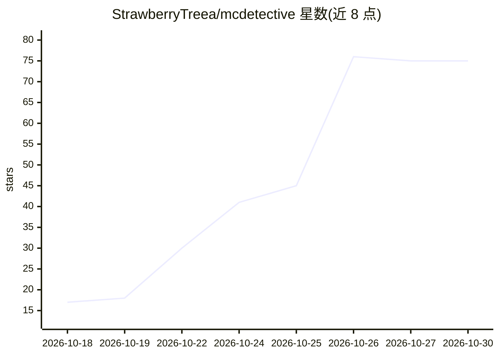

# StrawberryTreea/mcdetective

⭐ 75 · HTML · 推送 2026-10-14 · [GitHub](https://github.com/StrawberryTreea/mcdetective) · [官网](https://mcdetective.app.workbuddy.host) · 个人维护 · 中文 README

**调麦当劳 MCP 只读查价比货的 AI 侦探工具**

麦当劳程序员节参赛作品，以 WorkBuddy Skill 与 MCP App 形态交付：用户一句话报案（如「静安寺 麦香鱼哪家便宜」），它调用麦当劳 MCP 只读接口巡查附近门店，输出跨店价差、餐品可得性、热量与预算校验、积分盘点与点餐推荐。每条事实标注来源路径并留存原始请求/返回，可离线回放 Trace；算价失败会显式降级为菜单价。纯 Python 标准库，无第三方依赖，全程只读，不做下单等写操作。

## 筛选速览

| 维度 | 判定 | 备注 |
|---|---|---|
| AI 角色 | `ai-native` | 本体是模型或模型工具 |
| 许可风险 | `none` | — |
| 部署形态 | `None` |  |
| 模型依赖 | — | README 未给出锁定关系 |
| 硬件要求 | — | 无带数字的原话,不猜 |
| 安装摩擦 | `low` | 无编译、无系统依赖或容器化 |
| 成熟度 | — | 结构信号不足 |

## 能力要点

- 真实调用麦当劳 MCP 只读接口，产出跨店价差与可得性比对
- 事件式 Trace：每条事实带 sourcePath 与原始 request/response，可戳开核验
- 预算/热量硬校验，算价失败显式降级标注 priceSource=menu
- 纯 Python 标准库实现，零第三方依赖，自带离线回放 Studio

## 适用场景

- 比价附近麦当劳门店，找哪家便宜、哪家有货
- 按预算和热量上限获得点餐推荐
- 盘点麦当劳账户积分与券的资产情况
- 查看每条查询结果来自哪个接口哪个字段

## 场景标签

 · 领域:消费/生活工具

## 证据(README 行号)

> L17: **麦探长是一个实际可用的产品**（以 WorkBuddy Skill 形态交付）：用户用自然语言说一句需求，模型就**自主配置连接器、自主运行、自主把结果呈现出来**。本次参赛只是它的公开亮相与拿奖励的载体。
> L21: 下面是麦探长办北京中关村那宗案子的全过程，全部为**对麦当劳 MCP 的真实只读调用**（案号 `mcdetective-20261013-aafba506`，2026-10-13）。
> L226: 5. **全程只读**：本项目只调用查询类工具，**绝不**触发下单 / 抽奖等写操作。

## 星数曲线

2026-10-18 17 → 2026-10-30 75（+58）

---
*卡片 v1 · prompt 1.4 · 生成 2026-10-25 · 置信度 high · 依据 README sha `c0e03ef5e968` · [字段定义](../../DATASET.md)*
