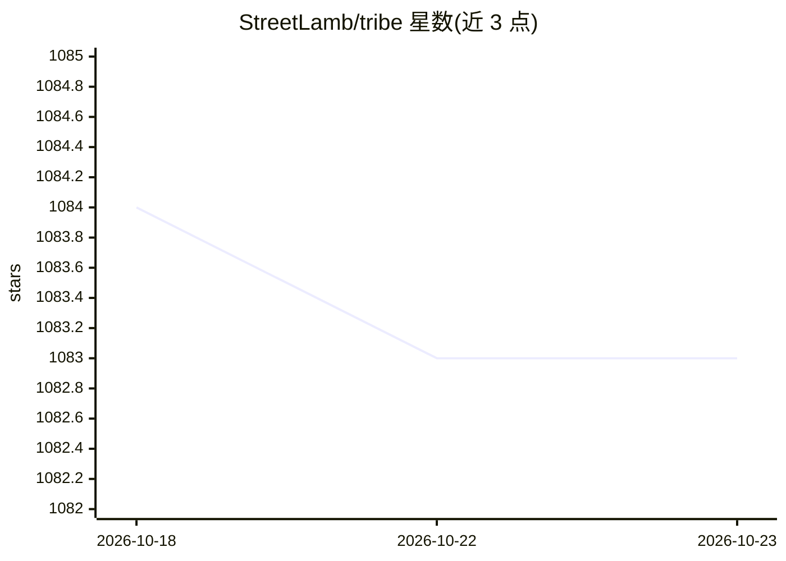

# StreetLamb/tribe

⭐ — · [GitHub]() · 个人维护

**低代码构建与协调多 agent 团队的开源工具**

基于 langgraph 框架的低代码工具，通过拖拽界面快速搭建和协调多 agent 团队，支持顺序与层级（团队领导-成员）两种工作流。提供持久化对话、LangSmith 可观测性、工具调用、RAG（默认 BAAI/bge-small-en-v1.5 嵌入）、Human-In-The-Loop、多租户与公共 API。模型接入支持 OpenAI 兼容端点及本地 Ollama 开源模型（llama、Gemma、Phi 等），默认内置 duckduckgo-search、wikipedia、yahoo-finance 三个技能，可用 skill 定义或 LangChain 编写自定义技能。通过 Docker 部署，需配置 SECRET_KEY 等环境变量。

## 筛选速览

| 维度 | 判定 | 备注 |
|---|---|---|
| AI 角色 | `ai-ecosystem` | LLM/agent 周边工具 |
| 许可风险 | `permissive` | — |
| 部署形态 | `None` |  |
| 模型依赖 | local-ok | 支持本地模型 |
| 硬件要求 | — | 无带数字的原话,不猜 |
| 安装摩擦 | `low` | 无编译、无系统依赖或容器化 |
| 成熟度 | — | 结构信号不足 |

## 能力要点

- 拖拽式低代码搭建顺序/层级多 agent 团队
- RAG 私有知识库，嵌入模型可通过环境变量更换
- 支持 Ollama 本地开源模型与 OpenAI 兼容端点
- Docker 部署、多租户与公共 API 集成

## 适用场景

- 不写代码快速搭建分工协作的 agent 团队（如客服、旅行规划）
- 让 agent 团队基于内部知识库做检索增强问答
- 本地用 Ollama 运行开源模型驱动 agent 团队

## 场景标签

`多智能体` `Agent 框架` `RAG` · 领域:Agent 开发

## 证据(README 行号)

> L22: Have you heard the saying, 'Two minds are better than one'? That's true for agents too. Tribe leverages on the lang
> L3:  ✨ Low code tool to rapidly build and coordinate multi-agent teams ✨

## 星数曲线

2026-10-18 1,084 → 2026-10-23 1,083（-1）

---
*卡片 v1 · prompt 1.4 · 生成 2026-10-21 · 置信度 high · 依据 README sha `db7c18726af4` · [字段定义](../../DATASET.md)*
