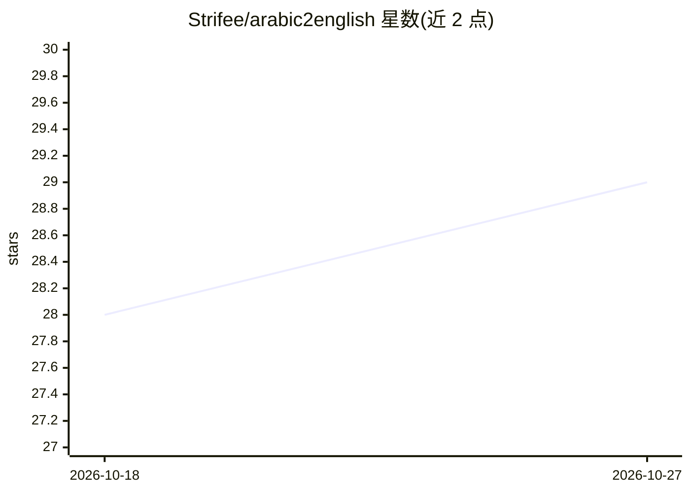

# Strifee/arabic2english

⭐ 29 · Jupyter Notebook · 推送 2026-04-01 · [GitHub](https://github.com/Strifee/arabic2english) · 个人维护

**从零训练的阿拉伯语→英语 Transformer 神经机器翻译实现**

基于 PyTorch 从零实现的阿拉伯语到英语神经机器翻译模型，采用 Attention Is All You Need 的 Transformer 架构：3 层编码器 + 3 层解码器、8 个注意力头、256 维嵌入，不使用预训练权重。安装需先配置 CUDA，再克隆仓库并通过 pip 安装依赖；训练通过运行 translate.py 完成，训练数据为阿拉伯语-英语翻译句对数据集。README 给出了批大小 16、学习率 0.0001、30 轮训练的超参数及正则化前后的结果示例。

## 筛选速览

| 维度 | 判定 | 备注 |
|---|---|---|
| AI 角色 | `ai-native` | 本体是模型或模型工具 |
| 许可风险 | `none` | — |
| 部署形态 | `library` | 以包/库形式分发 |
| 模型依赖 | — | README 未给出锁定关系 |
| 硬件要求 | — | 无带数字的原话,不猜 |
| 安装摩擦 | `medium` | 含编译或系统依赖之一 |
| 成熟度 | — | 结构信号不足 |

## 能力要点

- PyTorch 从零实现的自定义 Transformer（3+3 层、8 头、256 维嵌入）
- 不依赖预训练权重，训练脚本 translate.py 一键运行
- 提供正则化前后的训练对比与翻译结果示例

## 适用场景

- 学习 Transformer 架构在形态丰富语言对上的从零实现
- 复现并调整阿拉伯语→英语翻译模型的训练
- 作为 seq2seq/机器翻译课程或实验的参考代码

## 场景标签

`模型训练` `教程课程` · 领域:学习与行业

## 证据(README 行号)

> L3: **This is a PyTorch implementation of an Arabic to English Neural Machine Translation built using Transformers archi
> L13: - Custom Transformer (Attention Is All You Need)

## 星数曲线

2026-10-18 28 → 2026-10-27 29（+1）

---
*卡片 v1 · prompt 1.4 · 生成 2026-10-26 · 置信度 high · 依据 README sha `1650f91c79d4` · [字段定义](../../DATASET.md)*
