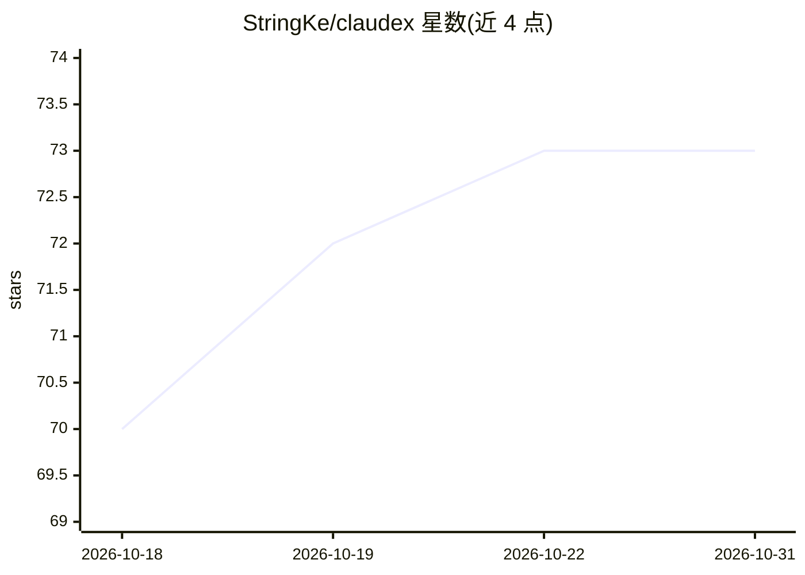

# StringKe/claudex

⭐ 73 · MDX · MIT · 推送 2026-02-27 · [GitHub](https://github.com/StringKe/claudex) · [官网](https://claudex.space) · 个人维护 · 中文 README

**多实例 Claude Code 管理器：协议翻译代理接入 20+ 模型服务商**

面向使用 Claude Code 的开发者：以本地代理（默认 127.0.0.1:13456）拦截 Claude Code 请求，做 Anthropic 协议与 OpenAI Chat Completions / Responses API 之间的双向翻译（含 SSE 流式与工具调用），从而接入 Anthropic、OpenRouter、DeepSeek、Ollama、LM Studio 等 20+ 服务商；支持 API Key 与 OAuth 订阅（ChatGPT、Claude Max、Copilot 等）两种认证。附带熔断故障转移、基于本地分类器的意图路由、上下文压缩与本地 RAG、TUI 面板与配置集管理。以 Rust 实现的 CLI 提供，macOS/Linux 一行脚本安装，Windows 从 Releases 下载预编译二进制，需已安装 Claude Code。

## 筛选速览

| 维度 | 判定 | 备注 |
|---|---|---|
| AI 角色 | `ai-ecosystem` | LLM/agent 周边工具 |
| 许可风险 | `permissive` | MIT |
| 部署形态 | `None` |  |
| 模型依赖 | local-ok | 支持本地模型 |
| 硬件要求 | — | 无带数字的原话,不猜 |
| 安装摩擦 | `low` | 无编译、无系统依赖或容器化 |
| 成熟度 | — | 结构信号不足 |

## 能力要点

- Anthropic ↔ OpenAI Chat Completions / Responses API 双向协议翻译，支持流式与工具调用
- 20+ 服务商接入，含 API Key 与 OAuth 订阅两种认证
- 熔断器 + 备用服务商自动故障转移，本地分类器意图路由
- TUI 面板实时展示 profile 健康度、指标与日志

## 适用场景

- 让 Claude Code 使用 DeepSeek、Kimi、GLM 等非 Anthropic 模型
- 用已有的 ChatGPT/Copilot 订阅驱动 Claude Code
- 多服务商配置切换与故障自动转移

## 场景标签

`模型网关` · 领域:Agent 开发

## 证据(README 行号)

> L24: Claudex is a unified proxy that lets Claude Code seamlessly work with multiple AI providers through automatic proto
> L28: - **Multi-provider proxy** — DirectAnthropic passthrough + Anthropic <-> OpenAI Chat Completions translation + Anth
> L72: The proxy intercepts requests and handles protocol translation:

## 星数曲线

2026-10-18 70 → 2026-10-31 73（+3）

---
*卡片 v1 · prompt 1.4 · 生成 2026-10-24 · 置信度 high · 依据 README sha `87cf10a75a25` · [字段定义](../../DATASET.md)*
