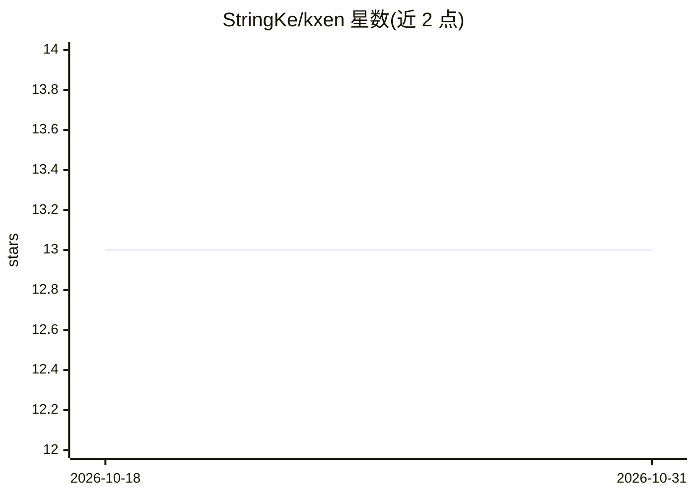

# StringKe/kxen

⭐ 13 · Rust · MIT · 推送 2026-10-27 · [GitHub](https://github.com/StringKe/kxen) · [官网](https://kxen.ai) · 个人维护

**本地优先的跨平台 Coding Agent 工作台与独立 agent CLI**

面向开发者的桌面/浏览器 Coding Agent 工作台：以 Workspace 与 Session 组织会话，对话可持久分支；内置 46 个 Provider 条目（含 AWS Bedrock、Google Vertex AI）支持多模型与按角色路由；提供 Goal、Subagent、Dynamic Workflow、Agent Teams 与 Bot-to-Bot 协作，高风险操作经执行层审批。核心机制 DCP（Deterministic Context Pipeline）先持久化可验证事实再投影为 Provider-neutral 上下文。另提供 kxen-agent 独立 CLI 用于 CI 与非交互任务。当前为开发预览版本。

## 筛选速览

| 维度 | 判定 | 备注 |
|---|---|---|
| AI 角色 | `ai-ecosystem` | LLM/agent 周边工具 |
| 许可风险 | `permissive` | MIT |
| 部署形态 | `library` | 以包/库形式分发 |
| 模型依赖 | locked-api |  |
| 硬件要求 | — | 无带数字的原话,不猜 |
| 安装摩擦 | `medium` | 含编译或系统依赖之一 |
| 成熟度 | `idea` | |

## 能力要点

- 对话持久分支树与中断后原子续跑
- 46 个内置 Provider 条目、多账号与按角色路由降级
- DCP 确定性上下文管道与 UNKNOWN 边界处理
- kxen-agent CLI 支持 resume、Git worktree 与 bundle 迁移

## 适用场景

- 在本地统一组织多模型 Coding Agent 会话与任务编排
- 让 Bot Group 协作完成重复工作单元
- 在 CI 中用 kxen-agent 非交互执行任务并恢复 Session

## 场景标签

`编码 Agent` `多智能体` · 领域:Agent 开发

## 证据(README 行号)

> L3: macOS、Windows 和 Linux 上的 Coding Agent 工作台，也可以用浏览器访问。把多模型供应商、目标驱动的任务执行、动态工作流、Agent 团队、独立 Bots、本地工具和长期知识组织在一个本地应用中，高风险
> L36: - **kxen-agent CLI**: 从 task 动态构建或加载 DCPAgent YAML，使用 immutable capability/policy lock 执行完整任务；支持 durable DCPRun、`--

## 星数曲线

2026-10-18 13 → 2026-10-31 13（+0）

---
*卡片 v1 · prompt 1.4 · 生成 2026-10-31 · 置信度 mid · 依据 README sha `64def44eccf5` · [字段定义](../../DATASET.md)*
