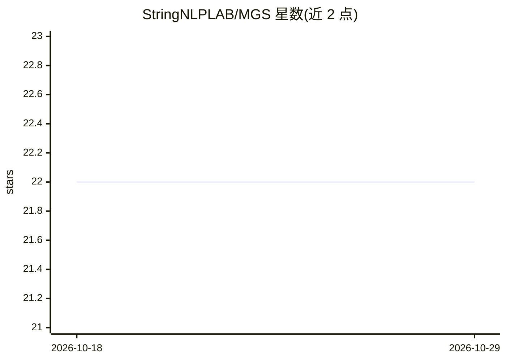

# StringNLPLAB/MGS

⭐ 22 · Python · MIT · 推送 2026-03-15 · [GitHub](https://github.com/StringNLPLAB/MGS) · 组织维护 · 中文 README

**论文实现：模块级梯度手术平衡 LLM 多目标 RL 训练**

Modular Gradient Surgery (MGS) 的官方实现：在 GRPO 强化学习后训练中，于模块层面解决数学推理、通用对话与指令遵循（IFEval）之间的梯度冲突，避免顺序训练或简单混合带来的领域性能受限。基于 RLMT/verl 框架构建，提供 MultiSourceRLHFDataset 控制批次数据配比、修改 DataParallelPPOActor 的 update_policy 实现梯度手术，并附带 PCGrad 对照示例、Math/IFEval 奖励函数与训练脚本。配套 Qwen-2.5-7B 与 Llama-3.1-8B 检查点发布于 Modelscope。

## 筛选速览

| 维度 | 判定 | 备注 |
|---|---|---|
| AI 角色 | `ai-ecosystem` | LLM/agent 周边工具 |
| 许可风险 | `permissive` | MIT |
| 部署形态 | `None` |  |
| 模型依赖 | — | README 未给出锁定关系 |
| 硬件要求 | — | 无带数字的原话,不猜 |
| 安装摩擦 | `low` | 无编译、无系统依赖或容器化 |
| 成熟度 | — | 结构信号不足 |

## 能力要点

- 模块级梯度冲突消解，支持数学/对话/指令遵循多域联合 RL 训练
- MultiSourceRLHFDataset 配合 WeightedRandomSampler 控制批次数据配比
- 提供 Math 与 IFEval 可验证奖励函数
- Qwen/Llama 系列训练检查点发布于 Modelscope

## 适用场景

- 多目标 RL 后训练中缓解梯度冲突
- 复现论文中的 MGS/PCGrad 对比实验
- 按配比混合异构数据源做 GRPO 训练

## 场景标签

`强化学习` · 领域:训练与推理

## 证据(README 行号)

> L7: This repository contains the official implementation of **Modular Gradient Surgery (MGS)**, a framework designed to 

## 星数曲线

2026-10-18 22 → 2026-10-29 22（+0）

---
*卡片 v1 · prompt 1.4 · 生成 2026-10-27 · 置信度 high · 依据 README sha `533783e00540` · [字段定义](../../DATASET.md)*
