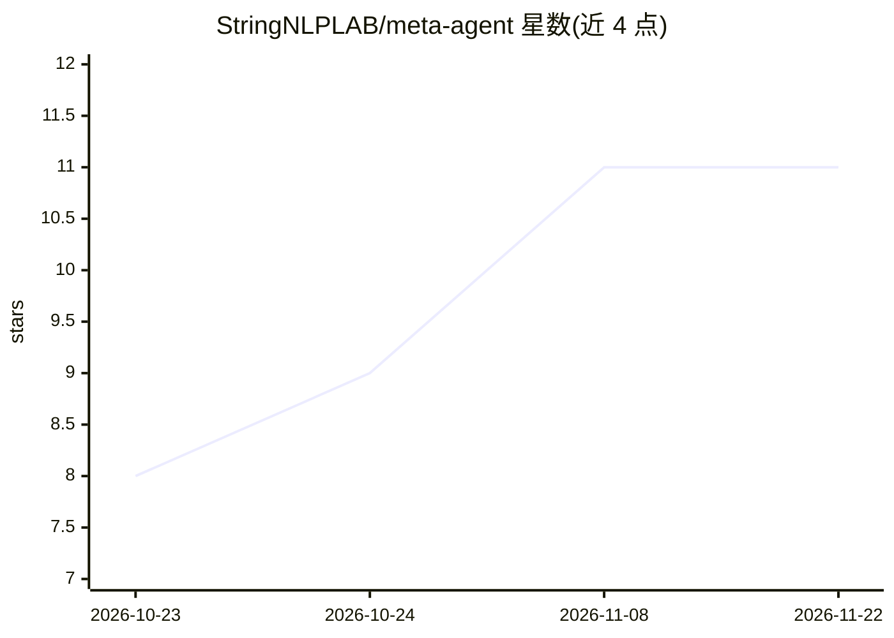

# StringNLPLAB/meta-agent

⭐ 11 · Python · MIT · 推送 2026-11-16 · [GitHub](https://github.com/StringNLPLAB/meta-agent) · 组织维护

**面向模型训练者的 skill：让 Codex 代理监督并改进长期训练实验**

基于论文 EAU 的 meta-agent skill，装入 Codex 技能目录后，用户以自然语言描述目标、资源、预算、审查节奏与允许修改范围，由 Codex 完成实验契约解析、训练启动、周期性审查与受控修改（目标函数、数据采样、优化器计划、批处理、吞吐等），并通过项目门验证改动生效。宿主需 Python 3、已认证的 Codex CLI 或兼容 agent 后端及训练环境；skill 不为每个训练框架提供已验证集成，宿主会话结束后无法维持进程。附 ATIF 轨迹导出与离线回归测试。

## 筛选速览

| 维度 | 判定 | 备注 |
|---|---|---|
| AI 角色 | `ai-ecosystem` | LLM/agent 周边工具 |
| 许可风险 | `permissive` | MIT |
| 部署形态 | `None` |  |
| 模型依赖 | — | README 未给出锁定关系 |
| 硬件要求 | — | 无带数字的原话,不猜 |
| 安装摩擦 | `low` | 无编译、无系统依赖或容器化 |
| 成熟度 | — | 结构信号不足 |

## 能力要点

- 自然语言描述目标与约束，Codex 转译为配置与命令并端到端执行
- 周期性审查机制：基于训练证据应用修改并验证 uptake 与结果
- 项目门（gate）作为程序化验证与执行接口控制改动范围
- 支持 ATIF 轨迹导出并可生成 Harbor 查看包

## 适用场景

- 让 agent 代为启动并长期监督长时间运行的训练实验
- 在授权范围内自动尝试并验证训练侧的改进假设
- 导出并查看 meta-agent 决策轨迹以做复盘

## 场景标签

`编码 Agent` `模型训练` `强化学习` · 领域:编码与开发

## 证据(README 行号)

> L7: A general skill for setting up, launching, supervising, and improving long-running model training experiments. It co
> L62: The host needs Python 3, an authenticated Codex CLI or compatible agent backend, the training environment, and a su

## 星数曲线

2026-10-23 8 → 2026-11-22 11（+3）

---
*卡片 v1 · prompt 1.4 · 生成 2026-11-18 · 置信度 high · 依据 README sha `115983601097` · [字段定义](../../DATASET.md)*
