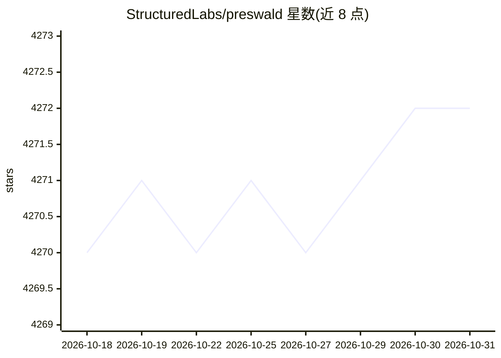

# StructuredLabs/preswald

⭐ 4,272 · Python · Apache-2.0 · 推送 2026-06-11 · [GitHub](https://github.com/StructuredLabs/preswald) · [官网](https://www.preswald.com/) · 组织维护

**用 Python 构建浏览器内单文件交互数据应用的框架**

面向数据分析师与开发者的静态站点生成器：以 Python 编写应用，通过 `preswald export` 打包为自包含的 .html 静态应用，在浏览器内基于 Pyodide + DuckDB 执行计算，无需服务器、可离线运行。提供预置 UI 组件、基于 DAG 依赖的响应式引擎，并用 preswald.toml 配置元数据与数据源。声明应用可被 AI agent 检查与修改，但核心功能不依赖 AI。Apache 2.0 许可，经 PyPI 安装。

## 筛选速览

| 维度 | 判定 | 备注 |
|---|---|---|
| AI 角色 | `ai-enhanced` | 去掉 AI 部分产品仍成立 |
| 许可风险 | `permissive` | Apache-2.0 |
| 部署形态 | `library` | 以包/库形式分发 |
| 模型依赖 | — | README 未给出锁定关系 |
| 硬件要求 | — | 无带数字的原话,不猜 |
| 安装摩擦 | `low` | 无编译、无系统依赖或容器化 |
| 成熟度 | — | 结构信号不足 |

## 能力要点

- 一条命令将 Python 应用打包为单文件静态 .html
- 浏览器内运行 Pyodide + DuckDB，离线无服务器
- 基于 DAG 依赖的响应式引擎，只重跑需要的部分
- 应用可被 AI agent 检查与修改（AI-ready）

## 适用场景

- 构建可分享给无需安装任何环境的干系人的仪表盘
- 将笔记本/报告打包为按用户输入实时更新的交互文件
- 为外勤或离线/隔离环境打包数据工具

## 场景标签

`数据分析` · 领域:效率与自动化

## 证据(README 行号)

> L33: Preswald is a static-site generator for building interactive data apps in Python. It packages compute, data access,
> L52: - AI-ready. Apps are fully inspectable and modifiable by agents

## 星数曲线

2026-10-18 4,270 → 2026-10-31 4,272（+2）

---
*卡片 v1 · prompt 1.4 · 生成 2026-10-20 · 置信度 high · 依据 README sha `3e6971e3fc61` · [字段定义](../../DATASET.md)*
